# Taller 2: Análisis de bloques de código dinámicos y vigilancia de archivos en vivo

**Curso:** Sistemas Operativos, LEAD University

**Estudiante:** Daniel Vásquez González

**Entorno:** Ubuntu 26.04.1 en VirtualBox 7.2.20 (máquina virtual "Ubuntu-SO", usuario `daniel`)

**Carpeta de trabajo:** `/home/daniel/lab_logs`

---

## Entrega

Todo el trabajo se entrega en este repositorio de GitHub.

**Archivos de salida (`salidas/`):** [entrega/salidas](https://github.com/DannyV1992/curso_sistemas_operativos/tree/main/Tareas/Taller_2/entrega/salidas)

**Scripts con mi firma (`reporte_log.sh` y `vigilar_log.sh`, con sus `reportes/` y `capturas/`):** [entrega/scripts](https://github.com/DannyV1992/curso_sistemas_operativos/tree/main/Tareas/Taller_2/entrega/scripts)

**Capturas de pantalla:** [Screenshots](https://github.com/DannyV1992/curso_sistemas_operativos/tree/main/Tareas/Taller_2/Screenshots)

Las dos carpetas de archivos que el enunciado pedía adjuntar en OneDrive (los archivos de salida y los scripts) se entregan como carpetas de este repositorio.

### Lista de verificación

- Actividad 1: capturas de la demostración, los ejercicios 1 a 4 y el checkpoint.
- Actividad 2: `salidas/` con 15 archivos (el mínimo era 5) y IPs externas arriba en el ranking.
- Actividad 3: `tail -f`, `tail -F`, `--line-buffered`, `tee`, rotación, `watch` y ejercicios 1 a 4.
- Actividad 4: rangos de horas, últimos 5 minutos, errores por minuto, `ventana.txt`, fechas de `web.log` y checkpoint.
- Actividad 5: `reporte_log.sh` (códigos de salida 0, 1 y 2, 2 reportes) y `vigilar_log.sh` (1 captura con 15 líneas, sin `tail` huérfano). Los dos llevan la firma en el encabezado.
- Desafío opcional: códigos HTTP de `web.log`.

---

## Paso 0: Preparación del entorno

Se creó la carpeta de trabajo `~/lab_logs`, se copió dentro `simulador_log.py` y se comprobó que funciona con `--help`. Luego se generó un log de 500 líneas con una semilla fija (`--semilla 42`, para que el resultado sea reproducible) y con ráfagas de errores (`--rafagas`).

**Comandos:**

```bash
mkdir -p ~/lab_logs && cd ~/lab_logs
ls -l simulador_log.py
python3 simulador_log.py --help
python3 simulador_log.py --lineas 500 --semilla 42 --rafagas
ls -l
wc -l app.log
```

**Respuesta:** `simulador_log.py` pesa 7701 bytes y el `--help` lista sus opciones. El simulador escribió 500 líneas en `app.log` y `wc -l` lo confirma: `500 app.log`.

> En esta captura los comandos `ls -l` y `wc -l app.log` aparecen juntos antes de sus salidas porque se pegaron de una sola vez. En las demás capturas se usó `set -x`, que muestra cada comando (con el prefijo `+`) justo encima de su resultado.

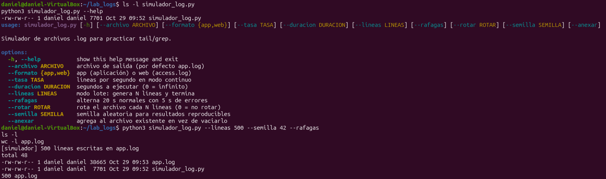

---

## Actividad 1: Lectura por bloques

Un log real puede tener millones de líneas, así que nunca se abre completo: se lee el inicio, el final o un rango.

### Demostración guiada

**Comandos:**

```bash
set -x
wc -l app.log
head -n 5 app.log
tail -n 5 app.log
tail -n +495 app.log
sed -n '100,110p' app.log
head -n 110 app.log | tail -n 11
set +x
```

**Respuesta:**

| Comando | Qué hace | Resultado observado |
|---|---|---|
| `wc -l app.log` | Cuenta las líneas | 500 |
| `head -n 5 app.log` | Las 5 primeras | De 09:28:18 a 09:28:31 |
| `tail -n 5 app.log` | Las 5 últimas (lo más reciente) | De 09:53:16 a 09:53:31 |
| `tail -n +495 app.log` | Desde la línea 495 hasta el final | 6 líneas (495 a 500) |
| `sed -n '100,110p' app.log` | Solo las líneas 100 a 110 | 11 líneas |
| `head -n 110 app.log \| tail -n 11` | Lo mismo, combinando comandos | Idéntico al de `sed` |

Con `tail -n +495` salen 6 líneas y no 5, porque el `+` indica "empezar en la línea 495" e incluye esa línea. En cambio `tail -n 5` significa "las últimas 5".

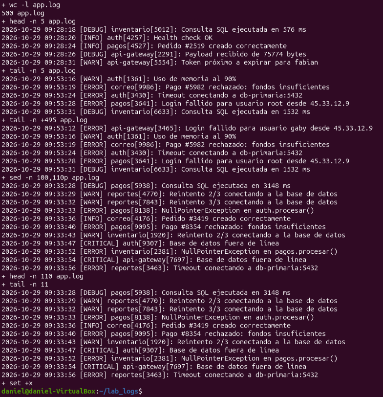

### Paginar con `less`

**Comando:** `less app.log`

**Respuesta:** `less` muestra el archivo por pantallas sin cargarlo completo. Con Espacio avanza una pantalla, con `b` retrocede, con `/ERROR` + Enter busca la palabra (resaltada en la captura), con `n` salta a la siguiente coincidencia y con `q` sale.

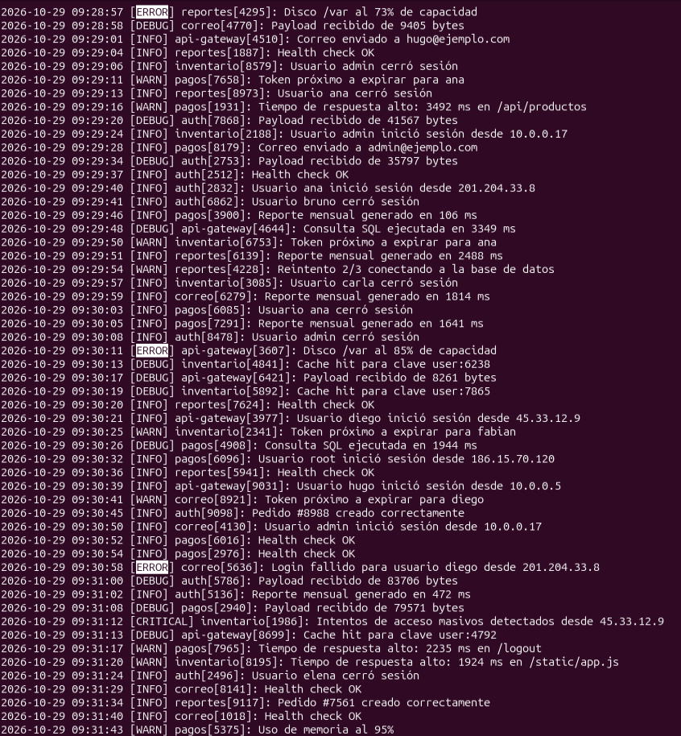

### Ejercicio 1: líneas 250 a 260 de dos formas

**Comandos:**

```bash
sed -n '250,260p' app.log
head -n 260 app.log | tail -n 11
```

**Respuesta:** Las dos formas muestran las mismas 11 líneas (de 09:40:23 a 09:40:57). `sed -n '250,260p'` imprime directamente el rango. La otra toma las primeras 260 líneas con `head` y se queda con las últimas 11 de ellas con `tail`.

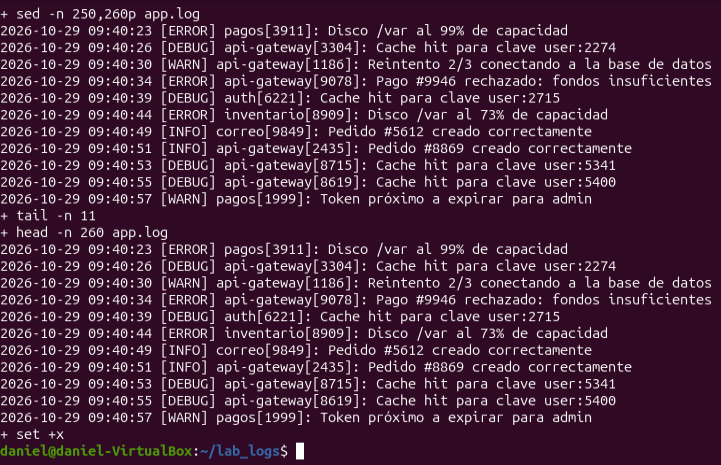

### Ejercicio 2: guardar las últimas 50 líneas

**Comandos:**

```bash
tail -n 50 app.log > ultimas50.txt
wc -l ultimas50.txt
head -n 3 ultimas50.txt
```

**Respuesta:** `tail -n 50 app.log > ultimas50.txt` no imprime nada porque la redirección `>` manda la salida al archivo. `wc -l` confirma `50 ultimas50.txt`.

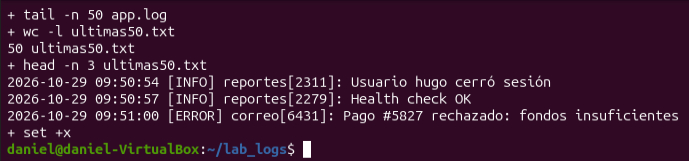

### Ejercicio 3: dividir el log en bloques de 100 líneas

**Comandos:**

```bash
split -l 100 app.log bloque_
ls bloque_*
wc -l bloque_*
```

**Respuesta:** Se crearon **5 archivos** (`bloque_aa`, `bloque_ab`, `bloque_ac`, `bloque_ad` y `bloque_ae`). Son 5 porque `app.log` tiene 500 líneas y cada bloque guarda 100 (500 / 100 = 5). `split` les pone los sufijos `aa`, `ab`, `ac`... en orden. `wc -l` muestra 100 líneas en cada bloque y 500 en total.

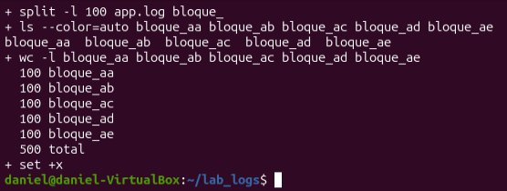

### Ejercicio 4: recorrer los bloques con un ciclo

**Comando:**

```bash
for b in bloque_*; do echo "== $b =="; head -n 1 "$b"; done
```

**Respuesta:** El ciclo recorre los 5 bloques en orden alfabético, imprime su nombre y la primera línea de cada uno. Las horas van creciendo: 09:28:18, 09:33:29, 09:38:18, 09:42:58 y 09:48:09. Esto se debe a que `split` corta el log en orden cronológico.

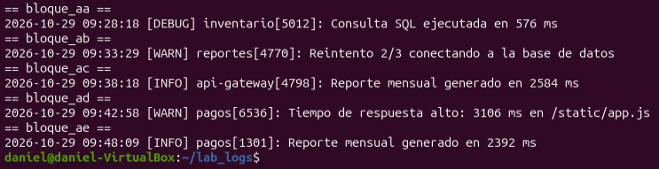

### Checkpoint de la Actividad 1

**Comando:**

```bash
ls bloque_* | wc -l ; wc -l ultimas50.txt
```

**Respuesta:** `split` produjo 5 archivos y `ultimas50.txt` tiene 50 líneas, como pedía el checkpoint.

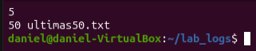

---

## Actividad 2: `grep` y salida a archivos

`grep` imprime solo las líneas que coinciden con un patrón. La redirección decide si ese resultado va a la pantalla o a un archivo. Todos los resultados de esta actividad se guardaron en la carpeta `salidas/`.

> Nota sobre la numeración: el enunciado repite el número 4 en dos ejercicios (el conteo por nivel y la investigación de seguridad). Aquí se llaman "Ejercicio 4a" y "Ejercicio 4b", en el orden en que aparecen.

### Demostración guiada

**Comandos:**

```bash
mkdir -p salidas
grep '\[ERROR\]' app.log > salidas/errores.txt
grep '\[CRITICAL\]' app.log >> salidas/errores.txt
wc -l salidas/errores.txt
grep 'Login fallido' app.log | tee salidas/logins.txt | wc -l
grep ERROR archivo_que_no_existe.log 2> salidas/fallos.txt
cat salidas/fallos.txt
```

**Respuesta:**

- El primer `grep` usa `>` y crea `errores.txt` con las líneas ERROR. El segundo usa `>>` y agrega las CRITICAL al final sin borrar lo anterior. `wc -l` da **97 líneas** (78 ERROR + 19 CRITICAL).
- `tee` guarda las líneas de `Login fallido` en `logins.txt` y a la vez se las pasa a `wc -l`, que cuenta **22**.
- `2>` redirige solo los mensajes de error (stderr). Por eso el error del archivo inexistente no sale en pantalla, queda en `fallos.txt` y `cat` lo muestra: `grep: archivo_que_no_existe.log: No such file or directory`.

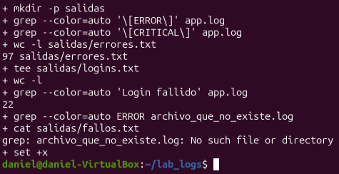

### Ejercicio 2: `grep -c ERROR` contra `grep -c '\[ERROR\]'`

**Comandos:**

```bash
grep -c ERROR app.log
grep -c '\[ERROR\]' app.log
```

**Respuesta:** Salen iguales, **78** en los dos casos. Aun así, el segundo es más preciso. `ERROR` a secas cuenta cualquier línea que contenga esa palabra en cualquier parte, incluso dentro de un mensaje o del nombre de un usuario. `'\[ERROR\]'` exige el nivel completo entre corchetes (los corchetes se escapan con `\` porque en una expresión regular `[ ]` tiene otro significado), así que cuenta solo el campo de nivel. En este log coinciden porque la palabra solo aparece como nivel, pero en un log real podrían diferir.

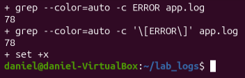

### Ejercicio 3: todo el log excepto las líneas DEBUG

**Comandos:**

```bash
grep -v '\[DEBUG\]' app.log > salidas/sin_debug.txt
wc -l salidas/sin_debug.txt
head -n 3 salidas/sin_debug.txt
grep -c '\[DEBUG\]' salidas/sin_debug.txt
```

**Respuesta:** `-v` invierte la búsqueda e imprime las líneas que NO coinciden. `sin_debug.txt` quedó con **443 líneas**, o sea que se quitaron 57 líneas DEBUG (500 - 443). La comprobación final, `grep -c` sobre el archivo nuevo, da `0`, así que no quedó ninguna.

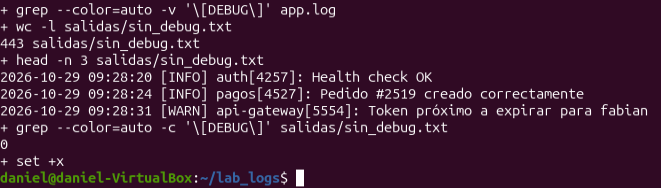

### Ejercicio 4a: conteo de líneas por nivel

**Comando:**

```bash
for n in DEBUG INFO WARN ERROR CRITICAL; do
  echo "$n: $(grep -c "\[$n\]" app.log)"
done > salidas/conteo_niveles.txt
cat salidas/conteo_niveles.txt
```

**Respuesta:**

| Nivel | Líneas |
|---|---|
| DEBUG | 57 |
| INFO | 257 |
| WARN | 89 |
| ERROR | 78 |
| CRITICAL | 19 |

La suma es 500, igual que el total del log. El ciclo `for` ejecuta el `grep -c` una vez por nivel. La redirección `>` está al final del `done`, así que guarda la salida de todo el ciclo en un solo archivo.

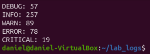

### Ejercicio 4b: investigación de seguridad, IPs con más logins fallidos

**Comando:**

```bash
grep 'Login fallido' app.log | grep -oE '[0-9]+(\.[0-9]+){3}' | sort | uniq -c | sort -rn > salidas/ips_sospechosas.txt
cat salidas/ips_sospechosas.txt
```

**Respuesta:**

| Intentos fallidos | IP |
|---|---|
| 7 | 45.33.12.9 |
| 7 | 201.204.33.8 |
| 4 | 186.15.70.120 |
| 2 | 10.0.0.17 |
| 1 | 192.168.1.10 |
| 1 | 10.0.0.5 |

La suma es 22, igual que los logins fallidos contados en la demostración. Arriba del ranking están las tres IPs externas (`45.33.12.9`, `201.204.33.8` y `186.15.70.120`), con 18 de los 22 intentos. Las IPs internas (`10.0.0.x` y `192.168.x.x`) casi no aparecen. Eso apunta a intentos de acceso desde fuera de la red.

Cómo funciona la cadena de comandos:

1. `grep 'Login fallido'` deja solo esas líneas.
2. `grep -oE` extrae únicamente la IP (`-o` imprime solo la parte que coincide y `-E` activa expresiones regulares extendidas).
3. `sort` agrupa las IPs iguales, porque `uniq` solo cuenta repeticiones consecutivas.
4. `uniq -c` cuenta cada grupo.
5. `sort -rn` ordena numéricamente de mayor a menor.

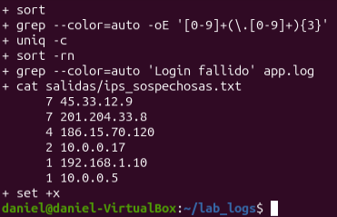

### Ejercicio 5: servicio que produce más errores

**Comando:**

```bash
grep '\[ERROR\]' app.log | awk '{print $4}' | cut -d'[' -f1 | sort | uniq -c | sort -rn > salidas/errores_por_servicio.txt
cat salidas/errores_por_servicio.txt
```

**Respuesta:**

| Errores | Servicio |
|---|---|
| 17 | reportes |
| 17 | pagos |
| 12 | auth |
| 12 | api-gateway |
| 10 | inventario |
| 10 | correo |

La suma es 78, igual que el total de líneas ERROR. Hay un empate: **`reportes` y `pagos`** producen más errores, con 17 cada uno. `awk '{print $4}'` extrae el cuarto campo (por ejemplo `reportes[4295]:`) y `cut -d'[' -f1` corta en el `[` para quitar el PID y quedarse solo con el nombre del servicio.

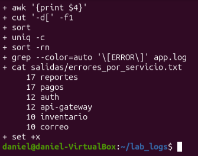

### Ejercicio 6: eventos CRITICAL con las 2 líneas anteriores

**Comandos:**

```bash
grep -B 2 '\[CRITICAL\]' app.log > salidas/criticos_contexto.txt
wc -l salidas/criticos_contexto.txt
head -n 20 salidas/criticos_contexto.txt
```

**Respuesta:** `-B 2` imprime 2 líneas antes de cada coincidencia, y `grep` separa los grupos con una línea `--`. El archivo tiene 67 líneas: los 19 eventos CRITICAL, sus líneas de contexto y los separadores `--`. Cuando dos CRITICAL están cerca, sus contextos se fusionan en un solo grupo.

¿Se ve alguna señal previa? **A veces, pero no de forma consistente.** En los primeros grupos:

- El CRITICAL de las 09:33:47 ("Base de datos fuera de línea") viene justo después de un `[WARN]` con "Reintento 2/3 conectando a la base de datos" (09:33:43). Ahí sí hay una señal previa clara.
- El CRITICAL de las 09:33:54 está precedido por un `[ERROR]` de `NullPointerException` y por el CRITICAL anterior. Los eventos graves vienen agrupados.
- Los CRITICAL de las 09:31:12, 09:35:01 y 09:38:39 tienen antes solo líneas INFO, DEBUG o un WARN de tiempo de respuesta alto, sin una señal clara.

Los CRITICAL tienden a aparecer en ráfagas (varios de ellos entre las 09:33 y las 09:35). Eso sirve como señal: si en pocos minutos suben los WARN y los ERROR, es probable que lleguen eventos CRITICAL. Pero por sí sola una línea previa no es un predictor confiable.

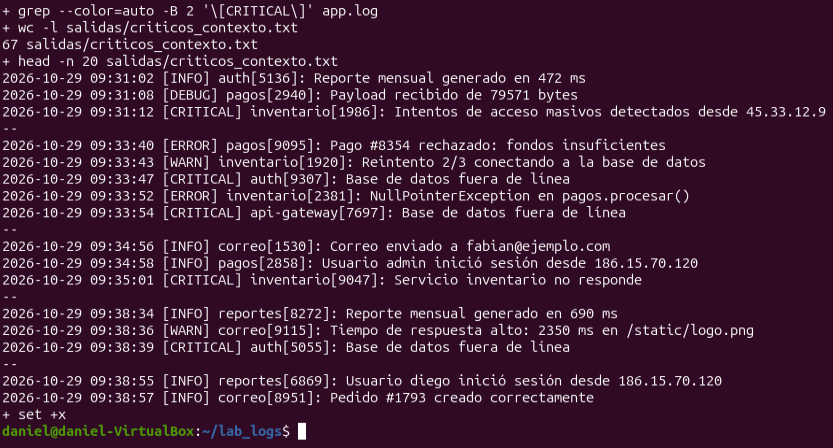

### Checkpoint de la Actividad 2

**Comandos:**

```bash
ls salidas/
ls salidas/ | wc -l
```

**Respuesta:** La carpeta `salidas/` tiene **8 archivos** (el mínimo pedido es 5): `conteo_niveles.txt`, `criticos_contexto.txt`, `errores.txt`, `errores_por_servicio.txt`, `fallos.txt`, `ips_sospechosas.txt`, `logins.txt` y `sin_debug.txt`. En el ranking de IPs aparecen arriba IPs externas, no `192.168.x.x`.

**Enlace a la carpeta `salidas/`:** [entrega/salidas](https://github.com/DannyV1992/curso_sistemas_operativos/tree/main/Tareas/Taller_2/entrega/salidas) (la carpeta del repositorio de GitHub tiene los archivos de salida de todas las actividades, no solo los 8 de este checkpoint).

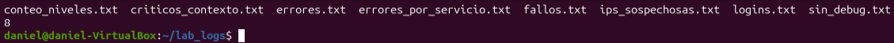

---

## Actividad 3: Seguimiento en tiempo real

`tail -f` mantiene el archivo abierto y muestra cada línea nueva en cuanto se escribe. Es la herramienta básica de monitoreo en servidores. Esta actividad se hace con **dos terminales** lado a lado: la Terminal 1 (izquierda) es el "servidor" que escribe el log en vivo y la Terminal 2 (derecha) es la persona operadora que observa.

> Antes de empezar se hizo una copia de respaldo del log (`cp app.log app_base.log`), porque el simulador en modo continuo vacía `app.log` al arrancar y ese archivo se necesita en las Actividades 4 y 5.

### Demostración guiada: `tail -f`

**Terminal 1:**

```bash
python3 simulador_log.py --tasa 3 --rafagas
```

**Terminal 2:**

```bash
tail -f app.log
```

**Respuesta:** El simulador escribe unas 3 líneas por segundo en `app.log`. A la derecha, `tail -f` muestra al arrancar las últimas 10 líneas del archivo y luego va imprimiendo cada línea nueva apenas se escribe. Se ve una ráfaga de ERROR, CRITICAL y WARN (por ejemplo a las 10:30:17 y 10:30:18), que es el comportamiento de `--rafagas`: unos segundos de errores cada cierto tiempo. Al detener el simulador con Ctrl+C informa `Fin. 44 líneas escritas.`

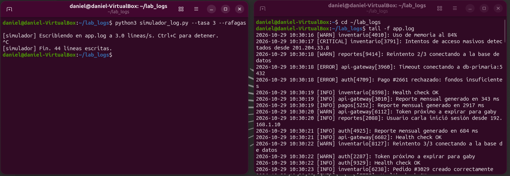

### `tail -n 0 -f`: solo lo nuevo

**Terminal 2:**

```bash
tail -n 0 -f app.log
```

**Respuesta:** `-n 0` le dice a `tail` que no muestre ninguna línea del contenido existente. Solo aparece lo que se escribe a partir de ese momento. Con `tail -f` a secas aparecen primero las 10 líneas finales del archivo.

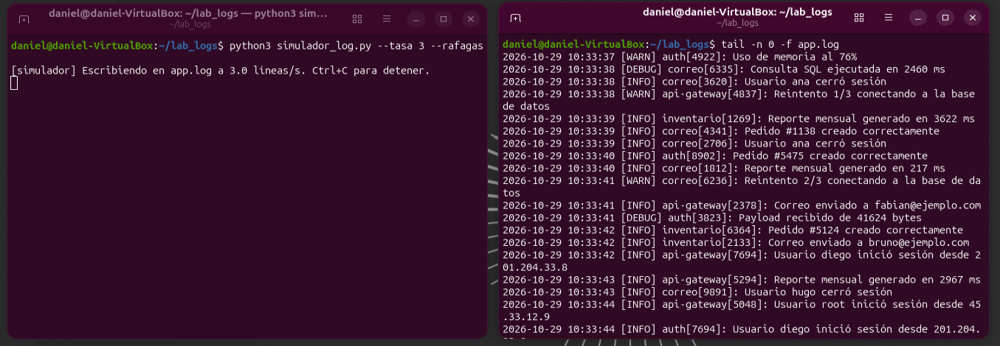

### Filtrar en vivo con `grep --line-buffered`

**Terminal 2:**

```bash
tail -f app.log | grep --line-buffered -E '\[(ERROR|CRITICAL)\]'
```

**Respuesta:** Solo se ven las líneas ERROR y CRITICAL, y `grep` las resalta en rojo. Las líneas INFO, DEBUG y WARN se descartan. `--line-buffered` obliga a `grep` a entregar cada línea de inmediato. Sin esa opción, cuando la salida de `grep` va a otra tubería o a un archivo, `grep` acumula las líneas en memoria y el resultado parece vacío durante un rato.

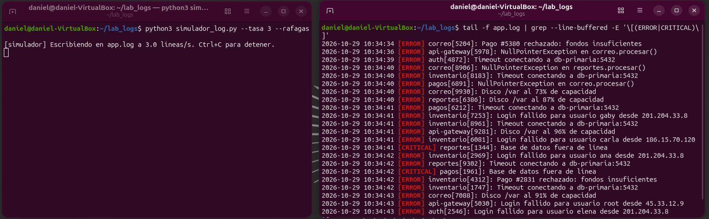

### Filtrar en vivo y guardar con `tee`

**Terminal 2:**

```bash
tail -f app.log | grep --line-buffered CRITICAL | tee salidas/criticos_vivo.txt
```

**Respuesta:** Muestra en pantalla solo las líneas CRITICAL y a la vez las guarda en `salidas/criticos_vivo.txt`. Se capturaron 7 eventos CRITICAL entre las 10:35:31 y las 10:35:37, todos dentro de una ráfaga. Sin `--line-buffered`, el `tee` no recibiría las líneas a tiempo.

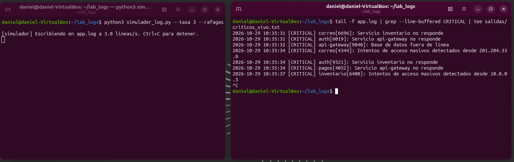


### `tail -f` contra `tail -F` (rotación de logs)

Los servidores renombran el log cuando crece (`app.log` pasa a `app.log.1`) y empiezan uno nuevo. `tail -f` se queda pegado al archivo viejo, mientras que `tail -F` vuelve a abrir el archivo por su nombre.

**Terminal 1 (en las dos pruebas):**

```bash
python3 simulador_log.py --tasa 5 --rotar 40
```

#### Con `tail -f`

**Terminal 2:**

```bash
tail -f app.log
```

**Respuesta:** Tras la rotación, el simulador avisa `Archivo rotado: app.log -> app.log.1` y sigue escribiendo líneas en el `app.log` nuevo (en total escribió 78). Pero `tail -f` dejó de mostrar líneas: la última que aparece es la de las 10:38:10, justo antes de la rotación, y la pantalla quedó congelada. Esto pasa porque `tail -f` sigue el archivo ya abierto, y ese archivo es ahora `app.log.1`, que no recibe nada nuevo. No hay ningún error ni aviso, simplemente deja de mostrar datos.

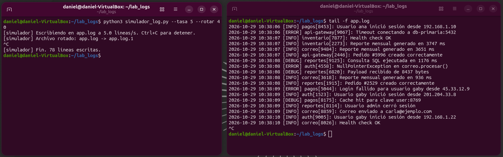

#### Con `tail -F`

**Terminal 2:**

```bash
tail -F app.log
```

**Respuesta:** Con `-F` mayúscula, `tail` detecta la rotación y lo avisa:

```text
tail: app.log: file truncated
tail: 'app.log' has become inaccessible: No such file or directory
tail: 'app.log' has appeared;  following new file
```

Después de ese aviso las líneas siguen apareciendo sin interrupción (10:39:08, 10:39:09, 10:39:10...), porque `tail -F` volvió a abrir `app.log` por su nombre y empezó a seguir el archivo nuevo.

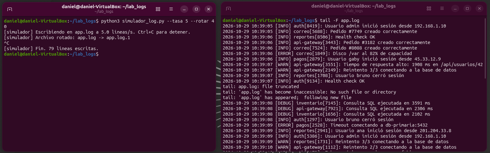

**Diferencia:** `tail -f` sigue el archivo (el descriptor abierto) y se pierde cuando ese archivo se renombra. `tail -F` sigue el nombre y se reengancha al archivo nuevo.


### Ejercicio 1: capturar solo `Login fallido` en vivo

**Terminal 1:**

```bash
python3 simulador_log.py --tasa 3 --rafagas
```

**Terminal 2:**

```bash
tail -f app.log | grep --line-buffered 'Login fallido' | tee salidas/logins_vivo.txt
wc -l salidas/logins_vivo.txt
```

**Respuesta:** Con el simulador en `--rafagas`, se dejó correr aproximadamente un minuto y medio (el simulador escribió 275 líneas en total) y se detuvo con Ctrl+C. Se capturaron **12 líneas** de `Login fallido`, entre las 10:40:55 y las 10:42:07. `wc -l` lo confirma: `12 salidas/logins_vivo.txt`. Nueve de los doce intentos vienen de IPs externas (`186.15.70.120`, `201.204.33.8` y `45.33.12.9`), igual que en el ranking de la Actividad 2.

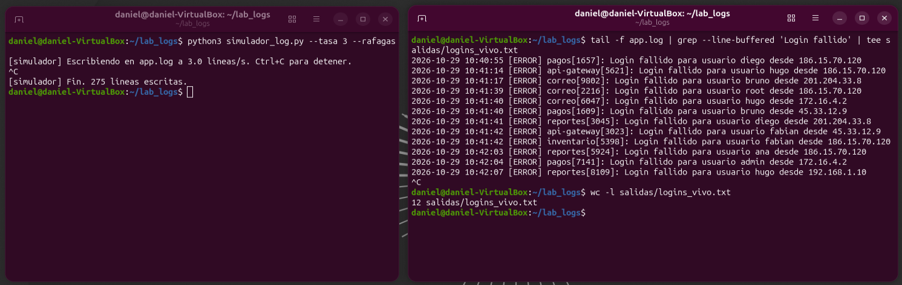


### Ejercicio 2: lo mismo sin `--line-buffered`

**Terminal 1:**

```bash
python3 simulador_log.py --tasa 3 --rafagas
```

**Terminal 2:**

```bash
tail -f app.log | grep 'Login fallido' | tee salidas/logins_sin_buffer.txt
```

**Terminal 3** (mientras las otras corren):

```bash
ls -l salidas/logins_sin_buffer.txt
grep -c 'Login fallido' app.log
```

**Respuesta:** La Terminal 2 se quedó en blanco, sin mostrar ninguna línea. El archivo `salidas/logins_sin_buffer.txt` existe pero pesa **0 bytes**, mientras que `app.log` ya contiene **20** líneas con `Login fallido`. Las líneas están en el log, pero no llegan al archivo.

La causa es que, cuando la salida de `grep` va a una tubería (`| tee`) en lugar de a la pantalla, `grep` usa un buffer de unos 4 KB y solo entrega los datos cuando se llena. Cada línea ocupa unos 100 bytes, así que hacen falta decenas de coincidencias para llenarlo, y como los `Login fallido` son pocos, el archivo parece vacío durante mucho tiempo. Con `--line-buffered`, `grep` entrega cada línea al instante, como se vio en el Ejercicio 1.

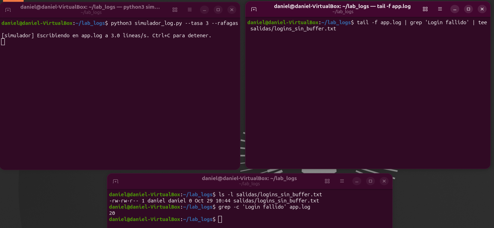


### Ejercicio 3: formato web y respuestas 5xx

**Terminal 1:**

```bash
python3 simulador_log.py --formato web --archivo web.log --tasa 4
```

**Terminal 2:**

```bash
tail -f web.log | grep --line-buffered -E '" 5[0-9]{2} '
```

**Respuesta:** El simulador escribe en `web.log` líneas con formato de `access.log` de Apache/Nginx, a 4 por segundo, y deja intacto `app.log`. El `grep` deja pasar solo las peticiones cuyo código de estado empieza con 5, es decir errores del servidor: en la captura salieron un `502` y varios `500` y `503`. El patrón `" 5[0-9]{2} ` busca una comilla, un espacio, un 5 seguido de dos dígitos y otro espacio. Esa combinación solo ocurre justo después de la petición (`"GET /login HTTP/1.1" 503 ...`), así que evita confundir el código de estado con otros números de la línea, como el tamaño de la respuesta o la IP. `grep` resalta el código en rojo.

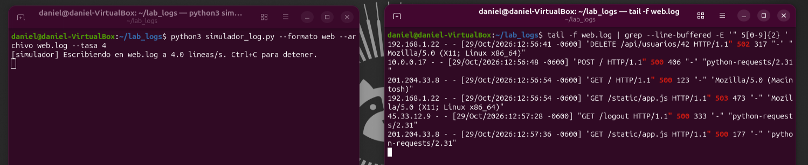


### Ejercicio 4: `watch`, conteo de errores refrescado cada 2 segundos

**Terminal 1:**

```bash
python3 simulador_log.py --tasa 3 --rafagas
```

**Terminal 2:**

```bash
watch -n 2 "grep -c ERROR app.log"
```

**Respuesta:** `watch` ejecuta el comando cada 2 segundos y muestra el resultado a pantalla completa, con el intervalo y la hora en la parte superior (`Every 2.0s: grep -c ERROR app.log`). En la captura marca 24 errores y el número va subiendo a medida que el simulador escribe, más rápido durante las ráfagas.

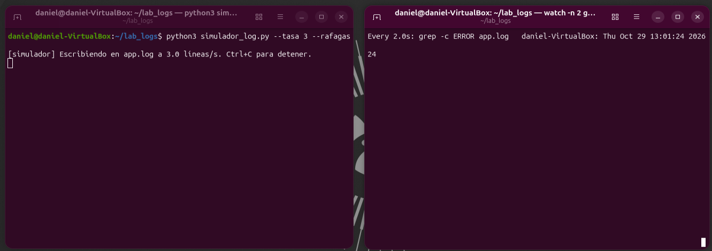

### Checkpoint de la Actividad 3

**¿Por qué en producción se prefiere `tail -F`?** Porque en producción los logs se rotan (se renombran y se crea uno nuevo), y `tail -F` sigue el archivo por su nombre, así que se reengancha al log nuevo y el monitoreo no se interrumpe, mientras que `tail -f` se queda pegado al archivo viejo y se pierden los eventos nuevos sin ningún aviso (ver las capturas de rotación).

---

## Actividad 4: Filtrar por rango de tiempo

Como la fecha va en formato `AAAA-MM-DD HH:MM:SS`, el orden alfabético coincide con el cronológico, así que `awk` puede comparar marcas de tiempo como si fueran texto.

> Durante la Actividad 3 el simulador sobrescribió `app.log`. Para esta actividad se restauró el log original de 500 líneas con `cp app_base.log app.log`.

### Demostración guiada: rango de horas de mi log

**Comandos:**

```bash
cp app_base.log app.log
wc -l app.log
head -n 1 app.log
tail -n 1 app.log
```

**Respuesta:** El log tiene 500 líneas. La primera es de las **09:28:18** y la última de las **09:53:31**, o sea que cubre unos 25 minutos del 29 de octubre de 2026. Esas horas son el rango sobre el que se ajustan los filtros siguientes.

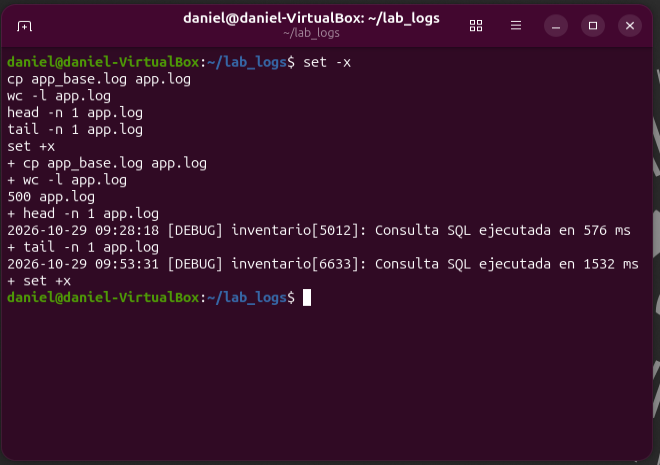

### Demostración guiada: eventos entre dos horas

**Comandos:**

```bash
awk '$2 >= "09:30:00" && $2 < "09:40:00"' app.log | wc -l
awk '$2 >= "09:30:00" && $2 < "09:40:00"' app.log | head -n 3
awk '$2 >= "09:30:00" && $2 < "09:40:00"' app.log | tail -n 3
```

**Respuesta:** `$2` es el segundo campo de la línea, la hora. La condición `$2 >= "09:30:00" && $2 < "09:40:00"` deja las líneas con hora desde las 09:30:00 inclusive hasta las 09:40:00 sin incluir. Hay **205 líneas** en esos 10 minutos. La primera es de las 09:30:03 y la última de las 09:39:57, así que el filtro respeta los dos límites. Solo se compara la hora porque todo el log es del mismo día.

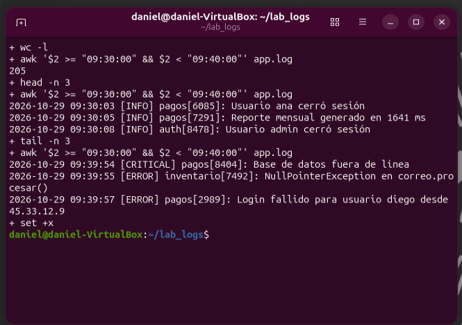


### Demostración guiada: eventos de los últimos 5 minutos

El enunciado calcula "hace 5 minutos" con la hora actual del sistema. `app.log` tiene horas de la mañana, así que no habría ninguna línea reciente. Por eso se generó un log aparte cuyas horas terminan casi en el momento actual:

```bash
python3 simulador_log.py --lineas 500 --semilla 42 --rafagas --archivo reciente.log
```

**Comandos:**

```bash
head -n 1 reciente.log
tail -n 1 reciente.log
desde=$(date -d '5 minutes ago' '+%Y-%m-%d %H:%M:%S' 2>/dev/null || date -v-5M '+%Y-%m-%d %H:%M:%S')
echo "Desde: $desde"
awk -v d="$desde" '($1" "$2) >= d' reciente.log > salidas/ultimos5min.txt
wc -l salidas/ultimos5min.txt
head -n 1 salidas/ultimos5min.txt
```

**Respuesta:** `reciente.log` va de las 12:40:40 a las 13:05:54. `date -d '5 minutes ago'` calcula la marca de hace 5 minutos (en Linux; el `||` prueba `date -v-5M` si el sistema es macOS) y la guarda en la variable `desde`: `2026-10-29 13:00:47`. `awk -v d="$desde"` pasa esa variable a `awk`, que compara fecha y hora juntas (`$1" "$2`) como texto y se queda con las líneas iguales o posteriores. El resultado, `salidas/ultimos5min.txt`, tiene **93 líneas**, y la primera es de las 13:00:48, la inmediatamente posterior al límite.

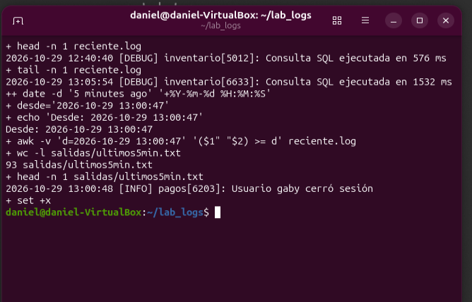

### Demostración guiada: errores por minuto

**Comandos:**

```bash
grep '\[ERROR\]' app.log | awk '{print substr($2,1,5)}' | uniq -c | tee salidas/errores_por_minuto.txt
```

**Respuesta:** `grep` deja solo las líneas `[ERROR]`, `substr($2,1,5)` toma de la hora solo `HH:MM` (los primeros 5 caracteres) y `uniq -c` cuenta cuántas líneas seguidas tienen el mismo minuto. No hace falta un `sort` antes porque el log ya está en orden cronológico y los minutos iguales quedan juntos. `tee` muestra la tabla y la guarda en `salidas/errores_por_minuto.txt`. La tabla tiene 23 minutos con al menos un error y los conteos suman los 78 errores del log.

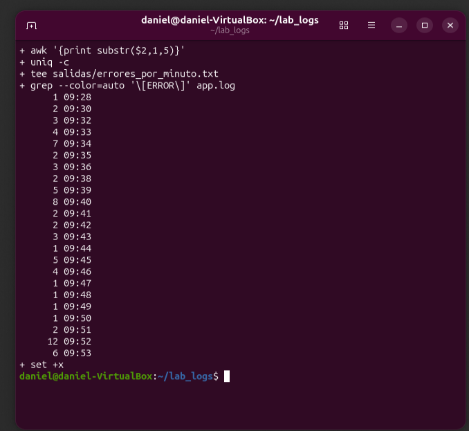

### Ejercicio 1: errores de una ventana de 10 minutos

**Comandos:**

```bash
awk '$2 >= "09:33:00" && $2 < "09:43:00" && /\[ERROR\]/' app.log > salidas/ventana.txt
wc -l salidas/ventana.txt
head -n 2 salidas/ventana.txt
tail -n 2 salidas/ventana.txt
```

**Respuesta:** Elegí la ventana de las 09:33:00 a las 09:43:00 (sin incluir). La misma condición de `awk` junta el rango de horas con el patrón `/\[ERROR\]/`, así que no hace falta un `grep` aparte. El archivo `salidas/ventana.txt` tiene **35 errores**. El primero es de las 09:33:33 y el último de las 09:42:51, ambos dentro de la ventana. Coincide con la tabla por minuto: los minutos 09:33 a 09:42 suman 4 + 7 + 2 + 3 + 0 + 2 + 5 + 8 + 2 + 2 = 35 (09:37 no tuvo errores).

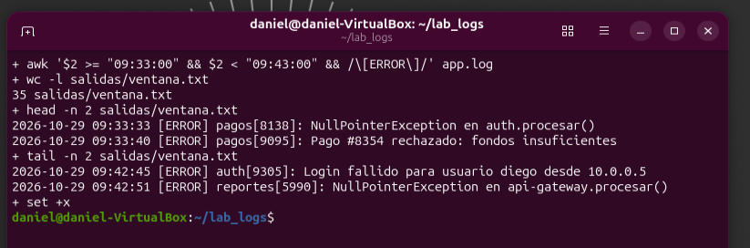

### Ejercicio 2: minuto con más errores

**Comandos:**

```bash
sort -rn salidas/errores_por_minuto.txt | head -n 5
```

**Respuesta:** Los cinco minutos con más errores son 09:52 (12), 09:40 (8), 09:34 (7), 09:53 (6) y 09:45 (5). **El minuto con más errores es las 09:52, con 12.** Sí coincide con una ráfaga: el simulador mete una ráfaga de errores cada 125 líneas (las líneas 100 a 124 de cada bloque), y las del log caen cerca de las 09:34 (líneas 100-124), las 09:40 (225-249) y las 09:52-09:53 (475-499). Los tres primeros puestos de la lista (09:52, 09:40 y 09:34) corresponden a esas ráfagas.

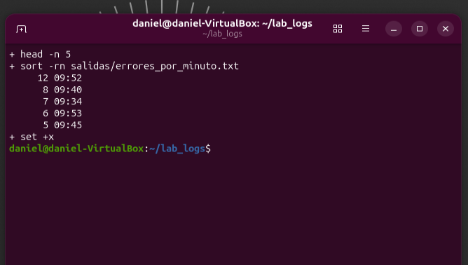

### Ejercicio 3: fechas de `web.log`

**Comandos:**

```bash
printf '%s\n' '[29/Oct/2026:23:59:59' '[01/Nov/2026:00:00:01' | sort
head -n 2 web.log
awk 'BEGIN{split("Jan Feb Mar Apr May Jun Jul Aug Sep Oct Nov Dec",m," "); for(i in m) mes[m[i]]=sprintf("%02d",i)} {split($4,f,/[\/:\[]/); print f[4]"-"mes[f[3]]"-"f[2], f[5]":"f[6]":"f[7]}' web.log | head -n 2
```

**¿Por qué la comparación de texto falla con `15/Oct/2026:11:36:42`?** Porque ese formato empieza por el día, luego va el mes con su nombre y al final el año. Comparar como texto va carácter por carácter de izquierda a derecha, así que se decide primero por el día y después por las letras del mes. Dentro de un mismo día sí funciona (la hora va al final, en orden), pero con varios días falla. En el `sort` de la captura, `[01/Nov/2026` queda **antes** que `[29/Oct/2026`, aunque el 1 de noviembre es posterior: `01` es menor que `29` como texto, y además `Nov` y `Oct` se ordenan alfabéticamente, no por número de mes.

**Solución propuesta:** convertir la fecha a un formato ordenable antes de comparar. El `awk` de arriba traduce el mes con una tabla (`Jan` a `01`, `Feb` a `02`...) y reordena los campos a `AAAA-MM-DD HH:MM:SS`, como en `app.log`. En la captura las dos primeras líneas quedan como `2026-10-29 12:56:15` y `2026-10-29 12:56:16`. Con ese formato la comparación de texto sí es cronológica. La otra opción es convertir cada fecha a epoch (segundos) con `date -d` o `mktime` de `awk` y comparar números.

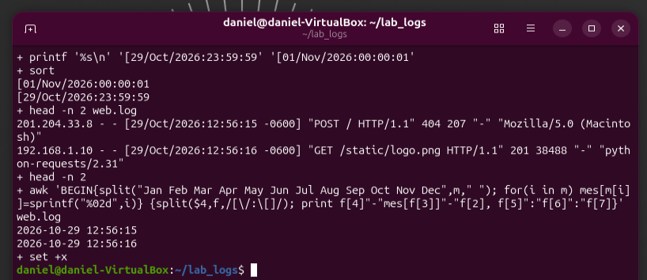

### Checkpoint de la Actividad 4

**¿Qué pasó entre las 09:50 y las 09:53?** Se responde con un solo comando:

```bash
awk '$2 >= "09:50:00" && $2 < "09:53:00" {print $3}' app.log | sort | uniq -c | sort -rn
```

**Respuesta:** `awk` filtra el rango de horas y deja solo el nivel (`$3`), y `sort | uniq -c | sort -rn` cuenta cuántos eventos hubo de cada nivel, de mayor a menor. Entre las 09:50 y las 09:53 hubo **27 INFO, 15 ERROR, 9 WARN, 4 DEBUG y 1 CRITICAL** (56 eventos en total). Es el tramo de la ráfaga final: 15 de los 56 eventos son errores (27 %), muy por encima del 16 % de errores que hay en todo el log (78 de 500).

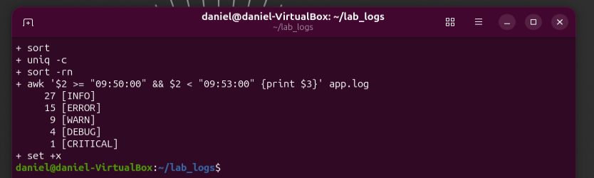

---

## Actividad 5: Scripts de análisis y vigilancia

Esta actividad junta lo anterior en dos scripts de Bash. Los dos llevan mi firma en un comentario del encabezado.

### `reporte_log.sh`: reporte de un log

Uso: `./reporte_log.sh [archivo] [umbral_errores]`. Por defecto analiza `app.log` con umbral 20.

```bash
#!/bin/bash
# reporte_log.sh - Reporte resumen de un archivo de log
# Uso: ./reporte_log.sh [archivo] [umbral_errores]
# Firma: Daniel Vásquez González (DannyV1992) - Sistemas Operativos, LEAD University, III Cuat. 2026

ARCHIVO="${1:-app.log}"
UMBRAL="${2:-20}"

# TODO 1: validar que el archivo exista
if [ ! -f "$ARCHIVO" ]; then
    echo "Error: no existe el archivo '$ARCHIVO'" >&2
    exit 1
fi

mkdir -p reportes
SALIDA="reportes/reporte_$(date +%Y%m%d_%H%M%S).txt"
ERRORES=$(grep -c '\[ERROR\]' "$ARCHIVO")

{
    echo "===== REPORTE DE $ARCHIVO ====="
    echo "Generado: $(date '+%Y-%m-%d %H:%M:%S')"
    echo "Total de líneas: $(wc -l < "$ARCHIVO")"
    echo

    # TODO 2: conteo por nivel con un for
    echo "--- Conteo por nivel ---"
    for NIVEL in DEBUG INFO WARN ERROR CRITICAL; do
        echo "$NIVEL: $(grep -c "\[$NIVEL\]" "$ARCHIVO")"
    done
    echo

    # TODO 3: top 5 servicios con errores
    echo "--- Top 5 servicios con errores ---"
    grep '\[ERROR\]' "$ARCHIVO" | awk '{print $4}' | sed 's/\[.*//' | sort | uniq -c | sort -rn | head -n 5
    echo

    # TODO 4: ranking de IPs con login fallido
    echo "--- IPs con Login fallido ---"
    grep 'Login fallido' "$ARCHIVO" | grep -oE '[0-9]+\.[0-9]+\.[0-9]+\.[0-9]+' | sort | uniq -c | sort -rn | head -n 5
    echo

    # TODO 5: últimos 5 CRITICAL
    echo "--- Últimos 5 CRITICAL ---"
    grep '\[CRITICAL\]' "$ARCHIVO" | tail -n 5
    echo

    # TODO 6: alerta por umbral
    if [ "$ERRORES" -ge "$UMBRAL" ]; then
        echo "ALERTA: $ERRORES errores (umbral: $UMBRAL)"
    else
        echo "OK: $ERRORES errores (umbral: $UMBRAL)"
    fi
} | tee "$SALIDA"

echo "Reporte guardado en $SALIDA"

if [ "$ERRORES" -ge "$UMBRAL" ]; then
    exit 2
fi
exit 0
```

**Cómo funciona:**

- Si el archivo no existe, escribe el error por `stderr` (`>&2`) y sale con código **1**.
- Los bloques del reporte van dentro de `{ ... } | tee "$SALIDA"`, así el reporte sale por pantalla y se guarda a la vez en `reportes/reporte_FECHA.txt`.
- El `for` recorre los cinco niveles y cuenta con `grep -c "\[$NIVEL\]"`.
- Para los servicios, `awk '{print $4}'` toma el campo `auth[1234]:` y `sed 's/\[.*//'` le quita desde el `[` en adelante.
- Los códigos de salida se calculan fuera del bloque, porque con la tubería hacia `tee` el `exit` de adentro no terminaría el script: **0** si todo está bien y **2** si los errores llegan al umbral.

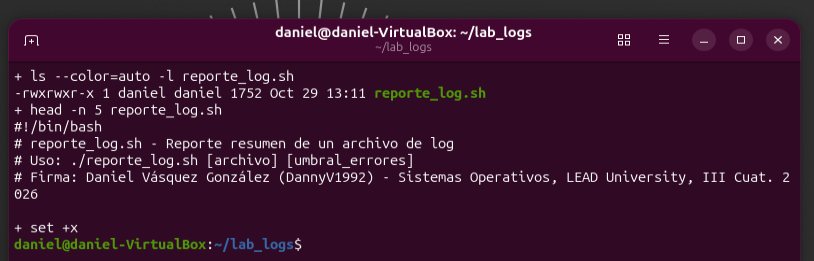

**Prueba con umbral superado** (`./reporte_log.sh app.log 50`): el reporte cuenta DEBUG 57, INFO 257, WARN 89, ERROR 78 y CRITICAL 19, los mismos números de la Actividad 2. Los servicios con más errores son `reportes` y `pagos` (17 cada uno), `auth` y `api-gateway` (12) e `inventario` (10). Las IPs con más `Login fallido` son las externas `45.33.12.9` y `201.204.33.8` (7 cada una) y `186.15.70.120` (4). Como 78 es mayor o igual que 50, imprime `ALERTA: 78 errores (umbral: 50)` y el código de salida es **2**.

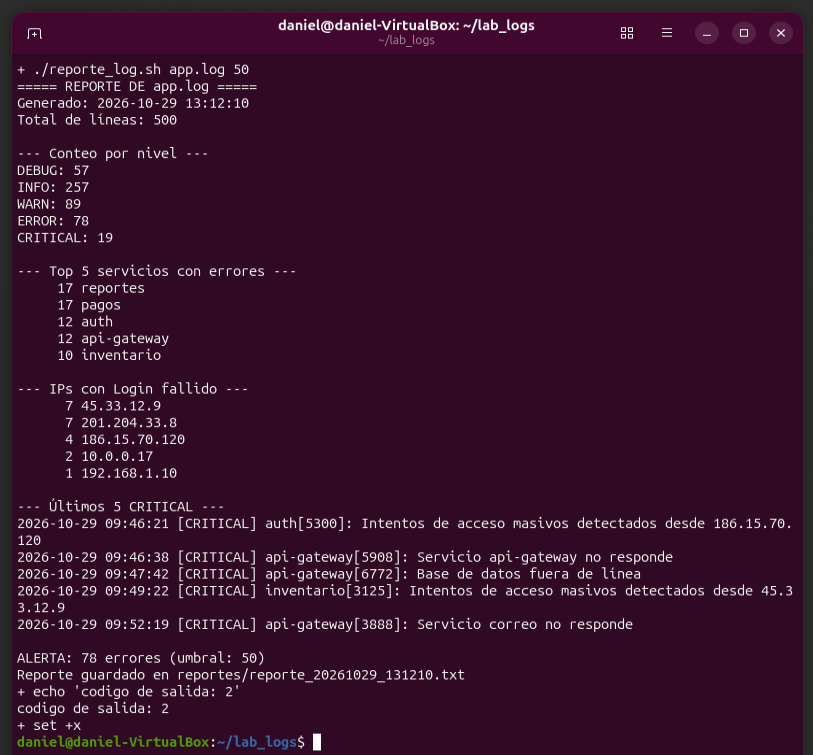

**Pruebas de los otros códigos de salida:**

```bash
./reporte_log.sh app.log 100 | tail -n 3
echo "codigo de salida: ${PIPESTATUS[0]}"
./reporte_log.sh no_existe.log
echo "codigo de salida: $?"
ls -l reportes/
```

Con umbral 100 imprime `OK: 78 errores (umbral: 100)` y el código es **0** (se usa `${PIPESTATUS[0]}` porque `$?` después de la tubería con `tail` devolvería el código de `tail`). Con un archivo inexistente muestra `Error: no existe el archivo 'no_existe.log'` y el código es **1**, sin crear reporte. `reportes/` queda con dos archivos.

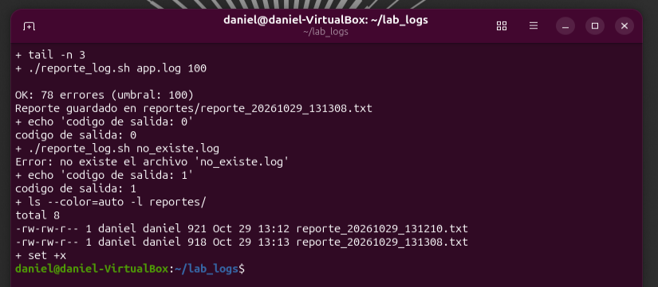

### `vigilar_log.sh`: vigilancia en vivo

Uso: `./vigilar_log.sh [archivo] [segundos] [patron]`. Por defecto vigila `app.log` durante 30 s con el patrón `ERROR|CRITICAL`.

```bash
#!/bin/bash
# vigilar_log.sh - Vigila un log en vivo durante N segundos y guarda las líneas que coinciden
# Uso: ./vigilar_log.sh [archivo] [segundos] [patron]
# Firma: Daniel Vásquez González (DannyV1992) - Sistemas Operativos, LEAD University, III Cuat. 2026

ARCHIVO="${1:-app.log}"
SEGUNDOS="${2:-30}"
PATRON="${3:-ERROR|CRITICAL}"

if [ ! -f "$ARCHIVO" ]; then
    echo "Error: no existe el archivo '$ARCHIVO'" >&2
    exit 1
fi

mkdir -p capturas
SALIDA="capturas/captura_$(date +%Y%m%d_%H%M%S).txt"

echo "Vigilando '$ARCHIVO' durante $SEGUNDOS s con el patrón '$PATRON'..."

# tail -F sigue el archivo aunque se rote; --line-buffered evita que grep retenga las líneas
tail -n 0 -F "$ARCHIVO" 2>/dev/null | grep --line-buffered -E "$PATRON" | tee "$SALIDA" &
PID=$!

sleep "$SEGUNDOS"

kill "$PID" 2>/dev/null
pkill -P $$ tail 2>/dev/null
wait 2>/dev/null

echo
echo "Vigilancia terminada. Líneas capturadas: $(wc -l < "$SALIDA")"
echo "Captura guardada en $SALIDA"
```

**Cómo funciona:** la tubería `tail | grep | tee` se lanza en segundo plano con `&` y `$!` guarda el PID del último proceso de esa tubería (`tee`). El script espera `SEGUNDOS` con `sleep` y después termina la tubería: `kill "$PID"` mata el `tee` y `pkill -P $$ tail` mata el `tail`, que es hijo directo del script y de otro modo seguiría vivo. Al final `wait` recoge los procesos y se cuenta cuántas líneas quedaron en la captura. Se usan `tail -n 0 -F` (solo lo nuevo y tolerante a rotación) y `grep --line-buffered` por lo visto en la Actividad 3.

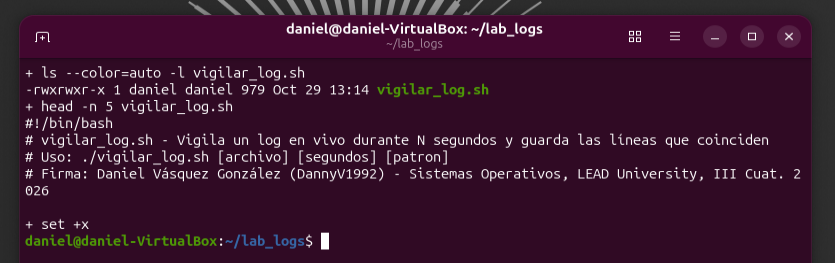

**Prueba en vivo con dos terminales.** Para no pisar `app.log`, el simulador escribió en otro archivo:

```bash
# Terminal 1
python3 simulador_log.py --archivo vivo.log --tasa 5 --rafagas --duracion 45

# Terminal 2
./vigilar_log.sh vivo.log 30
```

A la izquierda de la captura está el simulador (260 líneas escritas) y a la derecha el vigilante. Durante 30 segundos fueron apareciendo las líneas `[ERROR]` y `[CRITICAL]`, y al final el script terminó solo con `Líneas capturadas: 15`.

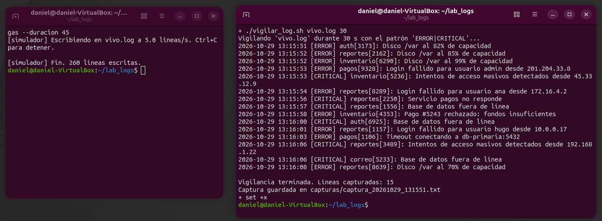

### Checkpoint de la Actividad 5

**Comandos:**

```bash
ls -l reportes/ capturas/
wc -l capturas/*.txt
head -n 3 capturas/*.txt
pgrep -a tail || echo "sin procesos tail huerfanos"
```

**Respuesta:**

- `reportes/` tiene **2 reportes** (el mínimo es 1).
- El script sale con código **2** cuando se supera el umbral (probado con `./reporte_log.sh app.log 50`).
- `capturas/` tiene **1 captura con 15 líneas** capturadas en vivo.
- `pgrep -a tail` no encuentra ningún proceso, así que `kill` y `pkill -P $$ tail` no dejaron ningún `tail` huérfano.

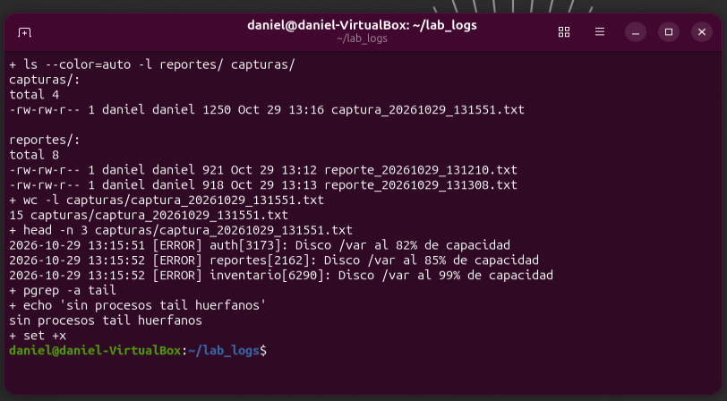


### Desafío opcional: códigos HTTP de `web.log`

**Comandos:**

```bash
wc -l web.log
awk '{print $9}' web.log | sort | uniq -c | sort -rn
```

**Respuesta:** En el formato web el código HTTP es la columna 9, así que `awk '{print $9}'` lo extrae y `sort | uniq -c | sort -rn` cuenta cuántas peticiones hubo de cada uno. De las **366 peticiones** de `web.log`, 150 fueron `200`, 76 `201` y 42 `304` (éxitos o respuestas en caché). Hubo 30 `404` y 23 `301`. Los códigos de error de autenticación y servidor fueron 18 `401`, 8 `403`, 10 `500`, 6 `502` y 3 `503`. Sumando todos los 4xx y 5xx (30 + 18 + 8 + 10 + 6 + 3) son 75 respuestas de error, cerca del 20 % del tráfico; de ellas, 19 son errores de servidor (5xx).

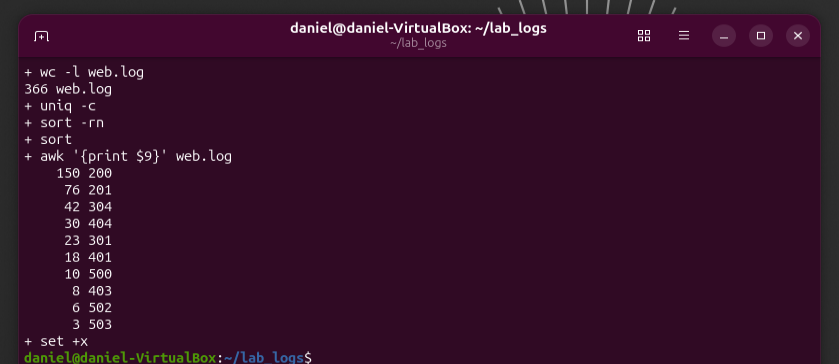
