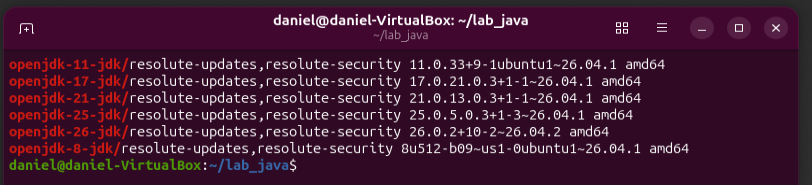
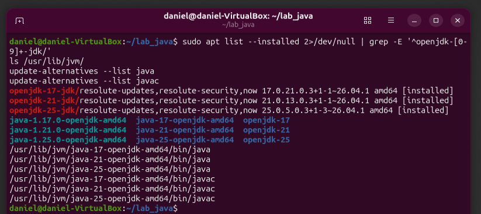
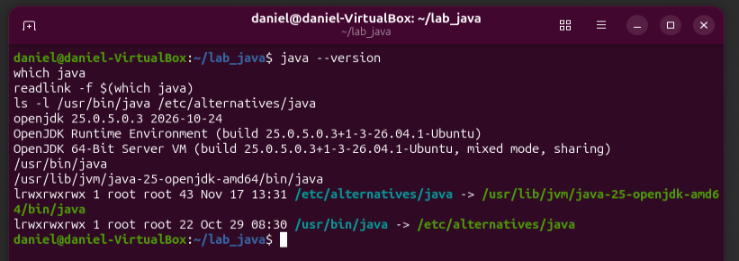
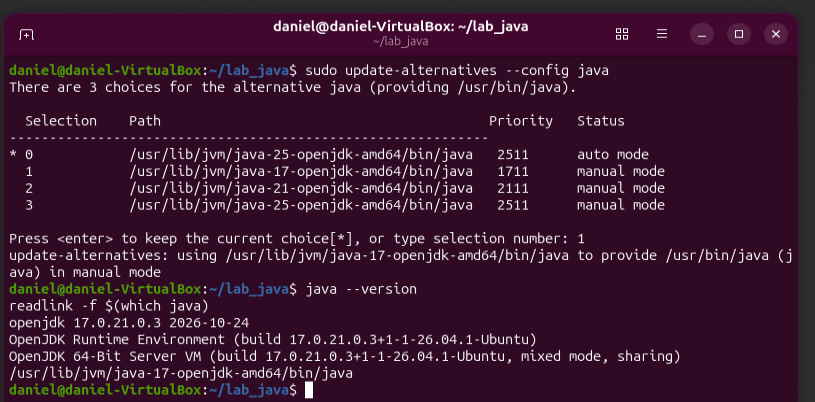
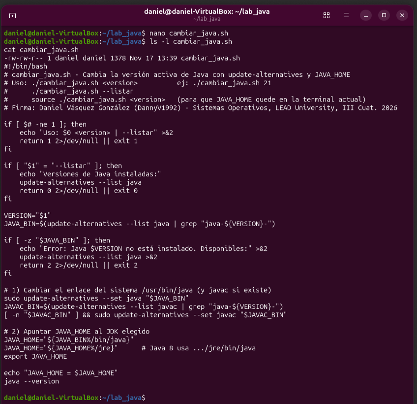
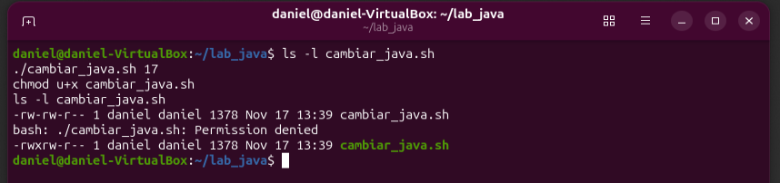
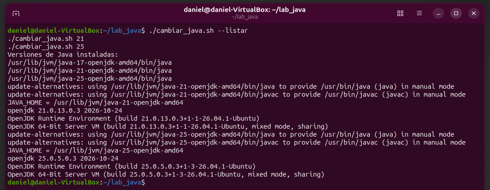
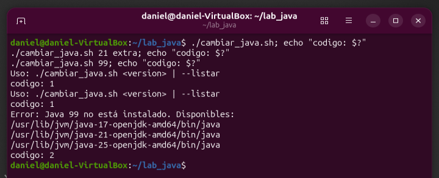
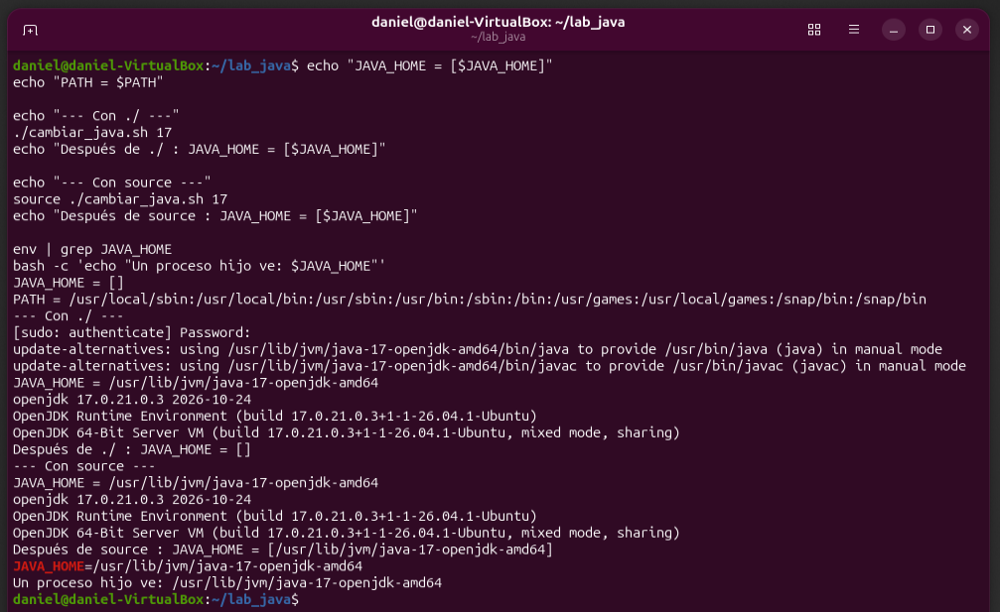
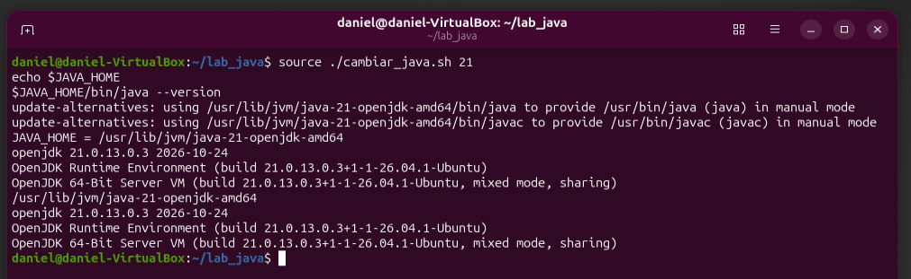

# Taller 3: Cambio de configuración de ejecución (Laboratorio 3)

**Curso:** Sistemas Operativos, LEAD University

**Estudiante:** Daniel Vásquez González

**Entorno:** Ubuntu 26.04.1 en VirtualBox 7.2.20 (máquina virtual "Ubuntu-SO", usuario `daniel`). Es un Ubuntu completo, así que `apt`, `update-alternatives` y `chmod` funcionan igual que en el subsistema Linux de Windows (WSL).

**Carpeta de trabajo:** `/home/daniel/lab_java`

---

## Entrega

Todo el trabajo se entrega en este repositorio de GitHub.

**Script (`cambiar_java.sh`, con mi firma en el encabezado):** [entrega/cambiar_java.sh](https://github.com/DannyV1992/curso_sistemas_operativos/blob/main/Tareas/Taller_3/entrega/cambiar_java.sh)

**Capturas de pantalla:** [Screenshots](https://github.com/DannyV1992/curso_sistemas_operativos/tree/main/Tareas/Taller_3/Screenshots)

### Lista de verificación

- Tres versiones de Java instaladas: 17, 21 y 25.
- Cómo saber cuál versión se ejecuta con `java --version`.
- Explicación y prueba de `update-alternatives`.
- Script `cambiar_java.sh`: recibe un parámetro, cambia la versión y devuelve códigos de salida 0, 1 y 2.
- Explicación de `chmod` y captura del script antes y después de hacerlo ejecutable.
- Explicación y demostración de las variables de entorno (`JAVA_HOME` y `PATH`).

---

## Paso 1: Elegir e instalar tres versiones de Java

Primero se consultó qué versiones del JDK ofrece Ubuntu 26.04:

```bash
sudo apt update
apt search openjdk 2>/dev/null | grep -E '^openjdk-[0-9]+-jdk/'
```

**Respuesta:** Los repositorios ofrecen los JDK 8, 11, 17, 21, 25 y 26. Se instalaron la **17, la 21 y la 25** porque las tres son versiones LTS (de soporte largo) y las tres aceptan el comando `java --version` que pide el enunciado. La versión 8 se descartó porque en Java 8 esa opción no existe (solo funciona `java -version`, con un solo guion).



**Instalación y comprobación:**

```bash
sudo apt install -y openjdk-17-jdk openjdk-21-jdk openjdk-25-jdk
sudo apt list --installed 2>/dev/null | grep -E '^openjdk-[0-9]+-jdk/'
ls /usr/lib/jvm/
update-alternatives --list java
update-alternatives --list javac
```

**Respuesta:** Los tres paquetes quedan como `[installed]`. En `/usr/lib/jvm/` aparece una carpeta por versión (`java-17-openjdk-amd64`, `java-21-openjdk-amd64` y `java-25-openjdk-amd64`), y `update-alternatives` lista las tres rutas tanto para `java` (el ejecutor) como para `javac` (el compilador).

> La salida de la instalación es muy larga, así que la captura muestra solo la comprobación posterior.



---

## Paso 2: Saber qué versión de Java se ejecuta

```bash
java --version
which java
readlink -f $(which java)
ls -l /usr/bin/java /etc/alternatives/java
```

**Respuesta:** `java --version` muestra **OpenJDK 25**, la versión activa por defecto. `which java` devuelve `/usr/bin/java`, pero ese archivo no es el programa real sino un **enlace simbólico**. La cadena completa es:

```
/usr/bin/java  ->  /etc/alternatives/java  ->  /usr/lib/jvm/java-25-openjdk-amd64/bin/java
```

`readlink -f` sigue esa cadena hasta el final y muestra el JDK real que se está ejecutando. Esa es la forma de saber cuál versión corre al escribir `java`.



---

## Paso 3: Qué es `update-alternatives`

`update-alternatives` es la herramienta de Ubuntu y Debian para administrar varias versiones de un mismo programa. Se encarga de mantener los enlaces simbólicos de la cadena anterior: `/usr/bin/java` apunta siempre a `/etc/alternatives/java`, y `update-alternatives` solo cambia el destino de este segundo enlace. Así, cambiar de versión no obliga a tocar ni mover ningún programa.

Cada alternativa tiene una **prioridad** (aquí 1711 para Java 17, 2111 para Java 21 y 2511 para Java 25) y el sistema puede estar en dos modos:

| Modo | Qué significa |
|---|---|
| `auto` | El sistema elige solo la alternativa de mayor prioridad (por eso arranca con Java 25) |
| `manual` | Se eligió una versión a mano y el sistema deja de cambiarla |

Opciones que se usaron:

| Comando | Qué hace |
|---|---|
| `update-alternatives --list java` | Lista las rutas instaladas |
| `sudo update-alternatives --config java` | Menú interactivo para elegir la versión |
| `sudo update-alternatives --set java RUTA` | Elige la versión sin menú (es lo que usa el script) |

**Prueba manual:**

```bash
sudo update-alternatives --config java
java --version
readlink -f $(which java)
```

**Respuesta:** El menú muestra las tres opciones, y el `*` marca la que está activa (la 0, en `auto mode`). Se escribió `1` para elegir Java 17, y el sistema respondió `using /usr/lib/jvm/java-17-openjdk-amd64/bin/java ... in manual mode`. Después, `java --version` muestra **OpenJDK 17** y `readlink` apunta a `java-17-openjdk-amd64`. Se necesita `sudo` porque se modifican enlaces del sistema en `/etc/alternatives`.



---

## Paso 4: El script `cambiar_java.sh`

El script automatiza lo que se hizo a mano en el paso anterior. Se escribió con el editor `nano` (`nano cambiar_java.sh`; se guarda con `Ctrl+O` y se sale con `Ctrl+X`).

Uso: `./cambiar_java.sh <version>` o `./cambiar_java.sh --listar`.

```bash
#!/bin/bash
# cambiar_java.sh - Cambia la versión activa de Java con update-alternatives y JAVA_HOME
# Uso: ./cambiar_java.sh <version>          ej: ./cambiar_java.sh 21
#      ./cambiar_java.sh --listar
#      source ./cambiar_java.sh <version>   (para que JAVA_HOME quede en la terminal actual)
# Firma: Daniel Vásquez González (DannyV1992) - Sistemas Operativos, LEAD University, III Cuat. 2026

if [ $# -ne 1 ]; then
    echo "Uso: $0 <version> | --listar" >&2
    return 1 2>/dev/null || exit 1
fi

if [ "$1" = "--listar" ]; then
    echo "Versiones de Java instaladas:"
    update-alternatives --list java
    return 0 2>/dev/null || exit 0
fi

VERSION="$1"
JAVA_BIN=$(update-alternatives --list java | grep "java-${VERSION}-")

if [ -z "$JAVA_BIN" ]; then
    echo "Error: Java $VERSION no está instalado. Disponibles:" >&2
    update-alternatives --list java >&2
    return 2 2>/dev/null || exit 2
fi

# 1) Cambiar el enlace del sistema /usr/bin/java (y javac si existe)
sudo update-alternatives --set java "$JAVA_BIN"
JAVAC_BIN=$(update-alternatives --list javac | grep "java-${VERSION}-")
[ -n "$JAVAC_BIN" ] && sudo update-alternatives --set javac "$JAVAC_BIN"

# 2) Apuntar JAVA_HOME al JDK elegido
JAVA_HOME="${JAVA_BIN%/bin/java}"
JAVA_HOME="${JAVA_HOME%/jre}"      # Java 8 usa .../jre/bin/java
export JAVA_HOME

echo "JAVA_HOME = $JAVA_HOME"
java --version
```

**Cómo funciona:**

- **Parámetros:** `$1` es el primer parámetro (la versión), `$#` es la cantidad de parámetros recibidos y `$0` es el nombre del script. Si no se recibe exactamente un parámetro, muestra el uso.
- **Búsqueda de la versión:** `update-alternatives --list java | grep "java-17-"` filtra la ruta que corresponde a la versión pedida.
- **Cambio del sistema:** `sudo update-alternatives --set` cambia `java` y también `javac`, para que el ejecutor y el compilador siempre sean de la misma versión.
- **`JAVA_HOME`:** se calcula quitando `/bin/java` del final de la ruta (`${JAVA_BIN%/bin/java}`) y se exporta con `export`.
- **`return ... || exit ...`:** si el script se carga con `source`, `return` evita cerrar la terminal; si se ejecuta normal, `return` falla y se usa `exit`.
- **Errores:** los mensajes salen por `stderr` (`>&2`).

**Códigos de salida:**

| Código | Situación |
|---|---|
| `0` | Cambio realizado, o `--listar` |
| `1` | Uso incorrecto (sin parámetro o con parámetros de más) |
| `2` | La versión pedida no está instalada |



---

## Paso 5: Qué es `chmod` y cómo se hizo ejecutable el script

`chmod` (*change mode*) cambia los **permisos** de un archivo. En Linux cada archivo tiene tres permisos para tres grupos de usuarios:

| Permiso | Letra | Significa |
|---|---|---|
| Lectura | `r` | Ver el contenido |
| Escritura | `w` | Modificarlo |
| Ejecución | `x` | Correrlo como programa |

| Grupo | Letra |
|---|---|
| Dueño del archivo (*user*) | `u` |
| Grupo del dueño (*group*) | `g` |
| Todos los demás (*others*) | `o` |

En `ls -l`, los permisos se leen en tres bloques de `rwx`, en el orden dueño, grupo y otros. Un archivo recién creado con `nano` **no es ejecutable**, aunque contenga un script. En `chmod u+x`, la `u` es el dueño, el `+` agrega un permiso y la `x` es el de ejecución. También se puede escribir en octal: el resultado `rwxrw-r--` equivale a `764`.

**Comandos:**

```bash
ls -l cambiar_java.sh
./cambiar_java.sh 17
chmod u+x cambiar_java.sh
ls -l cambiar_java.sh
```

**Respuesta:**

1. Antes: `-rw-rw-r--`, sin ninguna `x`.
2. Al intentar ejecutarlo: `bash: ./cambiar_java.sh: Permission denied`.
3. Después de `chmod u+x`: `-rwxrw-r--`, con la `x` del dueño, y el nombre aparece en verde.

La primera línea del script (`#!/bin/bash`, llamada *shebang*) le indica al sistema con qué intérprete ejecutarlo.

> En esta captura los comandos aparecen juntos antes de sus salidas porque se pegaron de una sola vez.



---

## Paso 6: Pruebas del script

**Cambio entre versiones:**

```bash
./cambiar_java.sh --listar
./cambiar_java.sh 21
./cambiar_java.sh 25
```

**Respuesta:** `--listar` muestra las tres rutas instaladas. Con `21`, `update-alternatives` cambia `java` y `javac` a `java-21-openjdk-amd64` en `manual mode`, el script imprime `JAVA_HOME = /usr/lib/jvm/java-21-openjdk-amd64` y `java --version` muestra OpenJDK 21. Luego con `25` ocurre lo mismo con la versión 25. En esta prueba no pidió contraseña porque `sudo` la recordaba de unos minutos antes.



**Casos de error:**

```bash
./cambiar_java.sh; echo "codigo: $?"
./cambiar_java.sh 21 extra; echo "codigo: $?"
./cambiar_java.sh 99; echo "codigo: $?"
```

**Respuesta:**

| Caso | Resultado | Código |
|---|---|---|
| Sin parámetro | `Uso: ./cambiar_java.sh <version> \| --listar` | **1** |
| Parámetro de más (`21 extra`) | El mismo mensaje de uso | **1** |
| Versión inexistente (`99`) | `Error: Java 99 no está instalado. Disponibles:` y la lista de rutas | **2** |



---

## Paso 7: Variables de entorno

Una **variable de entorno** es un par `NOMBRE=valor` que el sistema guarda para cada proceso. Cada proceso hereda las variables de su proceso padre. Las dos que importan en este taller:

| Variable | Para qué sirve |
|---|---|
| `PATH` | Lista de carpetas donde el shell busca los comandos. Por eso al escribir `java` se encuentra `/usr/bin/java` |
| `JAVA_HOME` | Indica dónde está el JDK. Herramientas como Maven, Gradle o los IDE la leen para saber qué Java usar |

Dos conceptos que hacen falta para entender la demostración:

- `export` hace que una variable se **herede** a los procesos hijos. Sin `export`, solo existe en el proceso actual.
- Un proceso hijo **no puede modificar** el entorno de su padre. Al terminar el hijo, sus cambios se pierden.

**Demostración** (en una terminal nueva, para que `JAVA_HOME` empiece vacío):

```bash
echo "JAVA_HOME = [$JAVA_HOME]"
echo "PATH = $PATH"

echo "--- Con ./ ---"
./cambiar_java.sh 17
echo "Después de ./ : JAVA_HOME = [$JAVA_HOME]"

echo "--- Con source ---"
source ./cambiar_java.sh 17
echo "Después de source : JAVA_HOME = [$JAVA_HOME]"

env | grep JAVA_HOME
bash -c 'echo "Un proceso hijo ve: $JAVA_HOME"'
```

**Respuesta:**

| Momento | `JAVA_HOME` |
|---|---|
| Al inicio, en la terminal nueva | `[]` (vacío) |
| Después de `./cambiar_java.sh 17` | `[]` (vacío) |
| Después de `source ./cambiar_java.sh 17` | `[/usr/lib/jvm/java-17-openjdk-amd64]` |
| Un proceso hijo (`bash -c`) | `/usr/lib/jvm/java-17-openjdk-amd64` |

Con `./cambiar_java.sh 17` el script corre en un **proceso hijo**: dentro del script `JAVA_HOME` sí vale la ruta de Java 17 (se ve en su propia salida), pero al terminar el hijo la variable desaparece, y la terminal sigue con `JAVA_HOME` vacío. Con `source` el script corre **dentro de la terminal actual**, así que la variable queda definida. El `export` del script hace que además la hereden los procesos hijos, como lo muestra `bash -c`.

`PATH` muestra las carpetas donde se buscan los comandos (`/usr/local/sbin:/usr/local/bin:/usr/sbin:/usr/bin:...`). El comando `java` se encuentra porque `/usr/bin` está en esa lista.

> Los comandos aparecen juntos antes de las salidas porque se pegaron de una sola vez.



**Para qué sirve `JAVA_HOME`:**

```bash
source ./cambiar_java.sh 21
echo $JAVA_HOME
$JAVA_HOME/bin/java --version
```

**Respuesta:** Después de cargar el script con `source`, `$JAVA_HOME/bin/java` ejecuta directamente el Java 21. Así las herramientas que leen `JAVA_HOME` encuentran el JDK correcto sin depender de `PATH`.



**`update-alternatives` y `JAVA_HOME` no son lo mismo:**

| | `update-alternatives` | `JAVA_HOME` |
|---|---|---|
| Qué cambia | Los enlaces del sistema (`/usr/bin/java`) | Una variable de la sesión |
| Alcance | Todo el sistema y todos los usuarios | Solo la terminal y sus procesos hijos |
| Necesita `sudo` | Sí | No |
| Persistencia | Permanente | Se pierde al cerrar la terminal (para que sea permanente se agrega `export JAVA_HOME=...` al `~/.bashrc`) |

El script cambia ambas cosas a la vez: así el comando `java` y las herramientas que usan `JAVA_HOME` apuntan siempre a la misma versión.
