# Taller 4: Uso de memoria y herramientas de procesamiento (Laboratorio 4)

**Curso:** Sistemas Operativos, LEAD University

**Estudiante:** Daniel Vásquez González

**Entorno:** Ubuntu 26.04.1 en VirtualBox 7.2.20 (máquina virtual "Ubuntu-SO", usuario `daniel`), con 3,3 GiB de RAM, 3,8 GiB de swap (archivo `/swap.img`), 2 CPU y un disco de 25 GB

**Carpeta de trabajo:** `/home/daniel/lab_mem`

---

## Entrega

Todo el trabajo se entrega en este repositorio de GitHub. Los archivos de datos (CSV de 1, 2 y 4 GB) **no** se incluyen por su tamaño; se regeneran con `generar_dataset.py` y la semilla por defecto.

**Scripts (los dos del profesor y los tres propios, con mi firma):** [entrega/scripts](https://github.com/DannyV1992/curso_sistemas_operativos/tree/main/Tareas/Taller_4/entrega/scripts)

**Resultados del monitoreo (una carpeta por corrida, 19 corridas):** [entrega/resultados](https://github.com/DannyV1992/curso_sistemas_operativos/tree/main/Tareas/Taller_4/entrega/resultados)

**Tabla resumen de todas las corridas:** [entrega/resumen_corridas.csv](https://github.com/DannyV1992/curso_sistemas_operativos/blob/main/Tareas/Taller_4/entrega/resumen_corridas.csv)

**Gráficas:** [graficas](https://github.com/DannyV1992/curso_sistemas_operativos/tree/main/Tareas/Taller_4/graficas)

**Capturas de pantalla:** [Screenshots](https://github.com/DannyV1992/curso_sistemas_operativos/tree/main/Tareas/Taller_4/Screenshots)

### Lista de verificación

- [x] Archivos de datos de 1, 2 y 4 GB (cada uno el doble del anterior) y uno de 200 MB para pruebas.
- [x] Monitoreo con `vmstat`, `free`, `top` y presión de memoria, guardado en archivos.
- [x] Explicación de qué mide cada comando.
- [x] Corridas en modo `chunks` y `full` con 1 GB.
- [x] Corridas con 2 GB (`chunks` y `full`) y con 4 GB (`chunks`). El modo `full` con 4 GB no se ejecutó porque ya con 2 GB el sistema mata el proceso.
- [x] Serie de 6 corridas por modo con 1 GB, alternando `full` y `chunks`.
- [x] Procesamiento de los resultados (memoria virtual, swapping, presión de memoria y correlación con los procesos) y gráficas.
- [x] Interpretación final de `full` frente a `chunks`.
- [x] Pregunta extra: monitoreo en Windows.

---

## La pregunta del laboratorio

**¿Qué sucede cuando se intenta analizar un archivo que supera la RAM disponible, y cómo se resuelve sin agregar memoria física?**

**Respuesta corta:** Si el programa carga todo el archivo en memoria (`full`), el sistema primero usa el swap en el disco, que es mucho más lento que la RAM; si el archivo es lo bastante grande, el swap también se llena y el kernel mata el proceso sin entregar resultado (así pasó con 2 GB en una máquina de 3,3 GiB de RAM). Se resuelve sin agregar memoria física cambiando **cómo** se procesa: leer el archivo por bloques (`chunks`) y acumular resultados parciales mantiene el uso de memoria constante (111 MiB) sin importar el tamaño del archivo. El detalle y las mediciones están en la sección de conclusiones.

---

## Material usado y cambios hechos

| Archivo | Origen | Qué hace |
|---|---|---|
| `generar_dataset.py` | Profesor (modificado, ver abajo) | Crea un CSV de ventas sintéticas escribiendo por bloques de unos 4 MiB, sin cargarlo en RAM |
| `analizar_datos.py` | Profesor | Calcula el importe total por región y categoría, en modo `full` (todo en memoria) o `chunks` (por bloques) |
| `monitorear.sh` | Propio | Registra `vmstat`, `free`, `top` y la presión de memoria mientras corre un análisis |
| `correr_corrida.sh` | Propio | Ejecuta una corrida completa: monitoreo, análisis y cierre |

**Cambio al generador.** `generar_dataset.py` solo aceptaba `--size-gb` entre 20 y 50, pero la máquina virtual tiene **11 GB libres** de disco y un archivo de 20 GB no cabe. Se bajó el mínimo a 1 GB (líneas 58, 59, 67 y 68 del script) y el resto del programa quedó igual. Con esto se pueden generar archivos de 1, 2 y 4 GB, que ocupan 7 GB en total.

**Cómo funciona `correr_corrida.sh`:**

1. Crea la carpeta `resultados/ARCHIVO_MODO_FECHA/`.
2. Vacía la caché de archivos del sistema (`sync` y `drop_caches`), para que todas las corridas partan en condiciones parecidas.
3. Lanza `monitorear.sh` en segundo plano, con una muestra por segundo.
4. Espera **10 segundos** antes de lanzar el análisis, como recomienda el enunciado, para ver cómo cambia la situación.
5. Ejecuta `analizar_datos.py` con los parámetros recibidos y guarda su salida en `analisis.txt`.
6. Anota en `marcas.txt` la hora de inicio, la de fin y el código de salida (un **137** significa que el sistema mató el proceso por falta de memoria).
7. Sigue monitoreando 10 segundos más y detiene el monitoreo.

**Archivos que genera cada corrida:**

| Archivo | Comando | Contenido |
|---|---|---|
| `vmstat.txt` | `vmstat -w -t 1` | Una línea por segundo, con la hora al final |
| `free.txt` | `free -m` | RAM y swap, en MiB para poder procesarlos, cada segundo |
| `psi.txt` | `cat /proc/pressure/memory` | Presión de memoria, cada segundo |
| `top.txt` | `top -b -n 1 -o %MEM` | Los procesos que más memoria usan, cada segundo |
| `analisis.txt` | `analizar_datos.py` | Salida del análisis, con duración y RSS máximo |
| `marcas.txt` | | Inicio, fin y código de salida |

El enunciado indica `free -h`; se usó `free -m` porque muestra los mismos datos en MiB exactos y no con redondeos como `1.3Gi`, lo que facilita procesarlos.

---

## Paso 0: Recursos de la máquina

```bash
ls -lh ~/lab_mem/*.csv
df -h /
free -h
swapon --show
```

**Respuesta:** La máquina tiene **3,3 GiB de RAM** (2,1 GiB disponibles con el escritorio abierto), **3,8 GiB de swap** (casi sin uso: 632 KiB) y 2 CPU. El disco es de 25 GB; antes de generar los datos había 11 GB libres y después de generarlos quedan **3,3 GB (86 % usado)**. Estas cifras definen el experimento: un archivo de 2 o 4 GB ya supera la RAM disponible, y la RAM más el swap suman unos 7 GiB.

> `ls -lh` muestra los tamaños en MiB y GiB (`954M`, `1.9G`, `3.8G`), mientras que el generador usa GB decimales (1,000 GB = 999 999 988 bytes).


---

## Paso 1: Qué mide cada comando de monitoreo

Los cuatro comandos se ejecutaron primero a mano, con la máquina en reposo, para conocer sus salidas:

```bash
vmstat 1 5
free -h
top -b -n 1 | head -n 12
cat /proc/pressure/memory
```


### `vmstat`: memoria virtual

Muestra una línea por intervalo con el estado del sistema. La primera línea es el **promedio desde el arranque**, no una medición del momento. Columnas principales:

| Grupo | Columna | Significado |
|---|---|---|
| `procs` | `r` | Procesos listos para ejecutar o ejecutándose |
| | `b` | Procesos bloqueados esperando entrada/salida (en la corrida, suben cuando hay swapping) |
| `memory` (KiB) | `swpd` | Memoria virtual en uso, es decir, cuánto está en el swap |
| | `free` | Memoria libre |
| | `buff`, `cache` | Memoria usada como caché de archivos (se devuelve si hace falta) |
| `swap` (KiB/s) | `si` | Memoria que **entra** desde el swap al disco → RAM |
| | `so` | Memoria que **sale** de la RAM al swap |
| `io` (bloques/s) | `bi`, `bo` | Bloques leídos y escritos en los dispositivos |
| `system` | `in`, `cs` | Interrupciones y cambios de contexto por segundo |
| `cpu` (%) | `us`, `sy` | Tiempo en modo usuario y en modo kernel |
| | `id` | Tiempo ocioso |
| | `wa` | Tiempo esperando a que termine una operación de disco |

En la captura, en reposo: `swpd` 632 KiB, `si` y `so` en 0 y la CPU casi siempre ociosa (`id` por encima del 90 %).

### `free`: RAM y swap usados

Resume la memoria física y el swap. La columna más útil es **`available`**: cuánta memoria se podría dar a un programa nuevo sin recurrir al swap, contando la caché que se puede liberar. En reposo: 3,3 GiB en total, 1,3 GiB usados, 2,1 GiB disponibles y 632 KiB de swap usado.

### `top`: procesos

Lista los procesos ordenados por uso de recursos y resume el estado general en el encabezado (tareas, CPU, memoria y swap). Para este taller importan las columnas por proceso:

| Columna | Significado |
|---|---|
| `VIRT` | Memoria virtual total reservada por el proceso |
| `RES` | Memoria física (RAM) que el proceso tiene realmente cargada ahora |
| `SHR` | Parte de `RES` que es compartida con otros procesos |
| `%CPU`, `%MEM` | Porcentaje de CPU y de RAM que usa |

Con `top` se **correlaciona** el comportamiento de la memoria con el proceso responsable (en reposo, el que más memoria usa es `gnome-shell`).

### Presión de memoria: `/proc/pressure/memory` (PSI)

PSI (*Pressure Stall Information*) mide cuánto tiempo pierden los procesos esperando por memoria. Tiene dos líneas:

| Línea | Significado |
|---|---|
| `some` | Porcentaje del tiempo en que **al menos un** proceso esperó por memoria |
| `full` | Porcentaje del tiempo en que **todos** los procesos útiles esperaron a la vez (la máquina no avanza) |

Cada línea trae `avg10`, `avg60` y `avg300` (promedio de los últimos 10, 60 y 300 segundos) y `total` (microsegundos acumulados). En reposo todos los promedios son `0.00`. Es el indicador más directo de que el sistema está sufriendo por falta de memoria, aun antes de que mate procesos.

---

## Paso 2: Generación de los datos

```bash
python3 generar_dataset.py --size-gb 1 --output ~/lab_mem/ventas_1gb.csv
python3 generar_dataset.py --size-gb 2 --output ~/lab_mem/ventas_2gb.csv
python3 generar_dataset.py --size-gb 4 --output ~/lab_mem/ventas_4gb.csv
```

**Respuesta:** Se generaron tres archivos, cada uno del doble del anterior, en 1,9 s, 3,8 s y 9,1 s. Además se creó uno de 200 MB (`--demo-mb 200`) para probar el monitoreo. El generador escribe por bloques de unos 4 MiB, así que no necesita RAM proporcional al archivo, y comprueba el espacio libre antes de empezar.

| Archivo | Tamaño exacto | Filas procesadas |
|---|---|---|
| `ventas_demo.csv` | 199 999 996 bytes | 4 575 207 |
| `ventas_1gb.csv` | 999 999 988 bytes | 22 878 219 |
| `ventas_2gb.csv` | 1 999 999 974 bytes | 45 754 872 |
| `ventas_4gb.csv` | 3 999 999 962 bytes | 91 511 526 |


---

## Paso 3: Prueba del monitoreo con el archivo chico

```bash
./correr_corrida.sh ~/lab_mem/ventas_demo.csv chunks
ls resultados/*/
cat resultados/*/marcas.txt
head -n 4 resultados/*/vmstat.txt
```

**Respuesta:** La corrida de prueba procesó 4 575 207 filas en 2,61 s con un RSS máximo de 111,3 MiB. La carpeta de resultados tiene los seis archivos esperados (`analisis.txt`, `free.txt`, `marcas.txt`, `psi.txt`, `top.txt` y `vmstat.txt`), `marcas.txt` registra `codigo_salida 0` y `vmstat.txt` guarda la hora de cada muestra (columna `CST`), que servirá para alinear las cuatro fuentes entre sí.

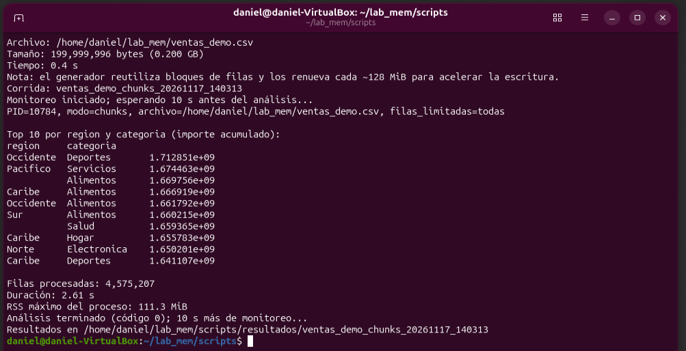

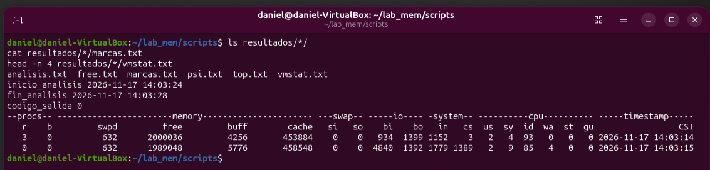

---

## Paso 4: Corridas exploratorias

### 4.1 Archivo de 1 GB

```bash
./correr_corrida.sh ~/lab_mem/ventas_1gb.csv chunks
./correr_corrida.sh ~/lab_mem/ventas_1gb.csv full --force
```

El modo `full` se niega a ejecutarse sin `--force`, porque el script estima que un CSV mayor al 35 % de la memoria disponible puede agotar la RAM. Aquí se forzó a propósito en una máquina virtual aislada.

| Modo | Filas | Duración | RSS máximo |
|---|---|---|---|
| `chunks` | 22 878 219 | 12,23 s | 111,2 MiB |
| `full` (1.ª corrida) | 22 878 219 | 62,46 s | 2653,7 MiB |
| `full` (2.ª corrida) | 22 878 219 | 45,47 s | 2548,0 MiB |

**Respuesta:** Los tres resultados numéricos son idénticos (el mismo Top 10 de región y categoría), pero el uso de recursos es muy distinto:

- `full` usó unas **23 veces más memoria** que `chunks` (unos 2,6 GiB frente a 111 MiB) y fue entre 3,7 y 5,1 veces más lento.
- El script estimó que el DataFrame completo ocupa **4252,5 MiB**, unas 4,5 veces el tamaño del CSV (954 MiB). Aun así el RSS máximo fue de 2,6 GiB: el resto **no cabía en la RAM** y el sistema lo mandó al swap. Con el escritorio ocupando 1,3 GiB, a Python le quedaban unos 2 GiB de RAM física.
- Las dos corridas de `full` no dieron el mismo tiempo (62,46 s y 45,47 s). Entre una corrida y otra queda swap ocupado de la anterior, como se ve en la segunda corrida: `swpd` ya valía 494 676 KiB antes de empezar. Por eso el laboratorio pide repetir las corridas.


**Las dos terminales en vivo.** A la izquierda corre `correr_corrida.sh` y a la derecha `tail -f` sobre el `vmstat.txt` de esa corrida:

```bash
tail -f "$(ls -dt ~/lab_mem/scripts/resultados/*/ | head -1)vmstat.txt"
```

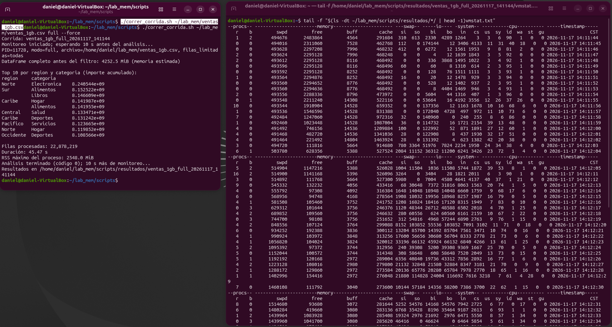

Lo que se ve en el `vmstat` de la captura a medida que avanza `full`:

- **Antes de cargar** (14:11:44 a 14:11:55): `swpd` estable en unos 483 MiB (swap que dejó la corrida anterior), `free` en 2,2 GiB y `cache` de unos 0,45 GiB. La máquina está tranquila.
- **Durante la carga** (14:11:56 a 14:12:04): `free` se desploma de 1,8 GiB a unos 100 MiB y `cache` **crece** de 0,63 a 1,4 GiB, porque el archivo CSV se lee a través de la caché de archivos.
- **Cuando la RAM se agota** (desde 14:12:05): `cache` cae a unos 0,3 GiB, o sea que el sistema **descarta la caché** para hacer sitio. `swpd` empieza a subir (de 0,5 GiB a más de 1,4 GiB) y aparecen `si` y `so` (por ejemplo, a las 14:12:21: `so` = 85 704 KiB/s, unos 84 MiB/s).
- **Efecto en la CPU** en ese momento: `sy` (modo kernel) = 74 %, `wa` (espera de disco) = 16 % e `id` = 0 %. La CPU se gasta administrando la memoria y esperando al disco, no calculando. Es el comportamiento típico de la **hiperpaginación** (*thrashing*), aunque aquí es moderado.
- Los procesos bloqueados (`b`) suben a 1 – 3 mientras duran las operaciones con el swap.

### 4.2 Archivo de 2 GB

```bash
./correr_corrida.sh ~/lab_mem/ventas_2gb.csv chunks
./correr_corrida.sh ~/lab_mem/ventas_2gb.csv full --force
```

| Modo | Filas | Duración | RSS máximo | Resultado |
|---|---|---|---|---|
| `chunks` | 45 754 872 | 24,62 s | 111,1 MiB | Terminó (código 0) |
| `full` | no terminó | unos 10 min 24 s hasta la muerte | 2,6 GiB al morir | **El sistema mató el proceso** |


**`chunks` con 2 GB** terminó sin problemas y con el mismo RSS que con 1 GB y que con 200 MB.

**`full` con 2 GB no terminó.** El script alcanzó a cargar el archivo (`DataFrame completo antes del filtro: 8504.7 MiB`), pero esa cifra ya es mayor que la RAM más el swap de la máquina (3,3 + 3,8 = 7,1 GiB), y la consulta todavía necesita copias adicionales. La pantalla se quedó sin respuesta varios minutos y al final el script apareció como `Terminated`:

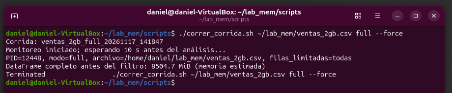

Casi al mismo tiempo, GNOME mostró el aviso *"Device memory is nearly full. An application was using a lot of memory and was forced to stop"* y la terminal indicó `Process Exited from Signal 9` (SIGKILL, una terminación forzada que el proceso no puede ignorar). El `pgrep` posterior confirma que no quedó ningún Python ni monitoreo huérfano (el único `python3` es `wsdd`, un servicio del sistema):


**Quién lo mató.** El registro del sistema (`journalctl`) lo dice con precisión:

```bash
sudo journalctl -b --no-pager | grep -i -E "oomd|memory pressure|out of memory|killed" | tail -n 10
```

```
14:29:21 kernel: systemd-oomd invoked oom-killer: ...
14:29:21 kernel: Out of memory: Killed process 12448 (python3) total-vm:6255856kB, anon-rss:2751244kB ...
```

Fue el **OOM killer del kernel**. El `12448` es exactamente el PID que imprimió el script al arrancar (`PID=12448`), así que murió el proceso de análisis. Cuando la memoria física y el swap se terminaron, el kernel eligió como víctima al proceso que más memoria ocupaba (el RSS de Python era de unos 2,6 GiB, `anon-rss`) y lo terminó. Como el script y el monitoreo corrían en la misma terminal, también se perdieron con ella, por eso la corrida no llegó a escribir `fin_analisis` ni `codigo_salida`.

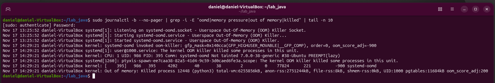

**Qué muestran los datos guardados** antes de la muerte (`marcas.txt` solo tiene `inicio_analisis 14:18:57`; el kernel mató el proceso a las 14:29:21, es decir, la máquina estuvo **más de 10 minutos** agonizando):

```bash
D="$(ls -dt ~/lab_mem/scripts/resultados/*/ | head -1)"
ls "$D"; cat "$D/marcas.txt"; tail -n 5 "$D/vmstat.txt"; tail -n 8 "$D/psi.txt"
```


| Indicador | Valor al final de la corrida | En reposo |
|---|---|---|
| `swpd` (swap usado) | 4 003 7xx KiB, unos 3,8 GiB: **el swap estaba completamente lleno** | 632 KiB |
| `free` | unos 90 MiB | 1,5 GiB |
| `cache` | unos 54 MiB: el sistema descartó casi toda la caché de archivos | 0,8 GiB |
| `wa` (espera de disco) | 88 % a 92 % | 0 % |
| `us` (CPU en modo usuario) | 0 % | |
| `b` (procesos bloqueados) | hasta **31** | 0 |
| PSI `some` (avg10 / avg60) | 12 – 23 % / 20 – 23 % | 0,00 |
| PSI `full` (avg10 / avg60) | 11 – 17 % / 16 – 19 % | 0,00 |

La CPU estaba casi toda en **espera de disco**: no calculaba, solo movía páginas entre la RAM y el swap. Es la hiperpaginación (*thrashing*) en su forma extrema: cuando el swap también se llena, el sistema ya no puede liberar espacio y solo le queda matar un proceso.

### 4.3 Archivo de 4 GB

```bash
./correr_corrida.sh ~/lab_mem/ventas_4gb.csv chunks
```

Solo se ejecutó el modo `chunks`. El modo `full` no se probó: con 2 GB ya muere, así que con 4 GB solo moriría antes y se arriesgaría a congelar la máquina virtual sin aportar un dato nuevo.

| Modo | Filas | Duración | RSS máximo | Resultado |
|---|---|---|---|---|
| `chunks` | 91 511 526 | 59,14 s | 111,1 MiB | Terminó (código 0) |


**Respuesta:** `chunks` procesó 91,5 millones de filas con los mismos 111 MiB de memoria. Un archivo de **4 GB** (más grande que toda la RAM de la máquina) se analiza sin problema, y el tiempo crece de forma casi lineal con el tamaño.

---

## Paso 5: Serie de corridas repetidas

Una sola corrida no basta: en el Paso 4.1 las dos corridas de `full` dieron 62,46 s y 45,47 s. Para separar el efecto del modo del ruido de la máquina virtual se hicieron **6 corridas por modo con el archivo de 1 GB, alternando** `chunks` y `full` (así cualquier deriva de la máquina, como swap sobrante o caché, afecta por igual a los dos modos). Cada corrida usa `correr_corrida.sh`, que vacía la caché de archivos antes de empezar.

```bash
for i in 1 2 3 4 5 6; do
  ./correr_corrida.sh ~/lab_mem/ventas_1gb.csv chunks
  ./correr_corrida.sh ~/lab_mem/ventas_1gb.csv full --force
done
```

**Resultados de las 12 corridas** (extraídos de `analisis.txt`, `vmstat.txt`, `free.txt` y `psi.txt`, ver [resumen_corridas.csv](entrega/resumen_corridas.csv)):

| Corrida | Duración (s) | RSS máx. (MiB) | Swap adicional (MiB) | Total enviado al swap (MiB) | `wa` promedio (%) | PSI `some` máx. (%) |
|---|---|---|---|---|---|---|
| `chunks` 1 | 20,96 | 111,2 | 0 | 0 | 1,4 | 0,0 |
| `full` 1 | 61,40 | 2641,2 | 1817 | 1833 | 16,5 | 59,6 |
| `chunks` 2 | 14,86 | 111,0 | 0 | 0 | 2,1 | 0,0 |
| `full` 2 | 54,23 | 2598,2 | 1727 | 1734 | 18,4 | 57,4 |
| `chunks` 3 | 15,77 | 111,1 | 0 | 0 | 1,9 | 0,0 |
| `full` 3 | 63,91 | 2666,2 | 1926 | 1890 | 15,4 | 47,4 |
| `chunks` 4 | 17,08 | 111,3 | 0 | 0 | 2,6 | 0,0 |
| `full` 4 | 78,16 | 2669,8 | 1721 | 2339 | 15,6 | 58,7 |
| `chunks` 5 | 18,47 | 111,2 | 0 | 0 | 2,4 | 0,0 |
| `full` 5 | 55,84 | 2663,4 | 1627 | 1645 | 13,3 | 50,7 |
| `chunks` 6 | 17,78 | 111,5 | 0 | 0 | 2,0 | 0,0 |
| `full` 6 | 60,35 | 2692,0 | 1635 | 1604 | 27,0 | 57,8 |

**Resumen por modo** (media, con mínimo y máximo entre paréntesis):

| Métrica | `chunks` | `full` |
|---|---|---|
| Duración (s) | 17,5 (14,9 a 21,0) | 62,3 (54,2 a 78,2) |
| RSS máximo (MiB) | 111,2 (111,0 a 111,5) | 2655,1 (2598,2 a 2692,0) |
| Swap adicional usado (MiB) | 0 | 1742 (1627 a 1926) |
| Total enviado al swap (MiB) | 0 | 1841 (1604 a 2339) |
| Total leído del swap (MiB) | 0 | 931 (639 a 1426) |
| Pico de `so` (KiB/s) | 0 | 150 961 (121 704 a 167 016) |
| CPU en espera de disco, promedio (%) | 2,1 (1,4 a 2,6) | 17,7 (13,3 a 27,0) |
| Procesos bloqueados, máximo | 0,7 (0 a 1) | 5,0 (4 a 8) |
| Memoria disponible mínima (MiB) | 1824 (1810 a 1841) | 63 (52 a 87) |
| PSI `some` máximo (%) | 0 | 55,3 (47,4 a 59,6) |
| PSI `full` máximo (%) | 0 | 42,2 (37,3 a 45,6) |
| Segundos con espera `some` | 0 | 19,7 (15,5 a 24,7) |

**Respuesta:** Con la misma entrada y el mismo resultado, `full` usó **23,9 veces más memoria** (razón de los RSS medios) y tardó **3,56 veces más** que `chunks`. La diferencia es estable: el mejor `full` (54,2 s) sigue siendo más lento que el peor `chunks` (21,0 s), y los RSS de `chunks` varían solo 0,5 MiB. Lo que sí varía en `full` es el tiempo (de 54,2 s a 78,2 s) porque depende de cuánto swap deje ocupado la corrida anterior y de cómo reparta el kernel las páginas. En ninguna de las seis corridas de `chunks` apareció swap, presión de memoria ni espera de disco apreciable.

Los mismos datos, leídos directamente de los archivos de la VM (los 12 `analisis.txt` y `marcas.txt`):

```bash
for d in $(ls -dt resultados/ventas_1gb_*/ | head -n 12 | sort); do
  printf "%-38s " "$(basename $d)"
  grep -h "Duración" $d/analisis.txt | tr '\n' ' '
  grep -h "RSS máximo" $d/analisis.txt | tr '\n' ' '
  grep -h codigo_salida $d/marcas.txt
done
```

Las 12 corridas terminaron con `codigo_salida 0`.

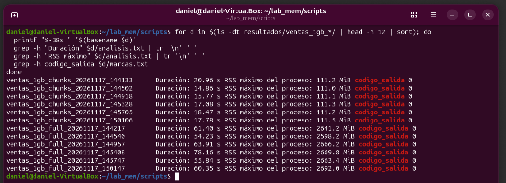

---

## Paso 6: Procesamiento de los resultados

Se escribió `analizar_resultados.py` (propio, en `entrega/scripts`). Lee las carpetas de `resultados/`, convierte cada archivo de monitoreo a tablas con pandas y las **alinea por la hora de la muestra** (`vmstat -t` trae la hora de cada línea y los demás archivos llevan una marca `### hora`). Después calcula las métricas por corrida, la correlación entre series y las gráficas.

```bash
cd entrega/scripts
python -I analizar_resultados.py
```

Cómo se obtiene cada magnitud que pide el enunciado:

| Magnitud | Fuente | Qué se calcula |
|---|---|---|
| Memoria virtual | `vmstat` (`swpd`) y `free` (swap usado, disponible) | Swap adicional máximo y memoria disponible mínima |
| Swapping | `vmstat` (`si`, `so`) | Pico de `so` y total enviado y leído del swap (suma de KiB/s con muestras de 1 s) |
| Presión de memoria | `/proc/pressure/memory` | Máximo de `avg10` en `some` y `full`, y segundos con espera |
| Procesos | `top` (columna `RES`) | `RES` del proceso `python` más grande, solo dentro de la ventana del análisis |
| Disco | `vmstat` (`wa`, `b`) | Espera de disco promedio y procesos bloqueados |

### Gráfica 1: la serie completa

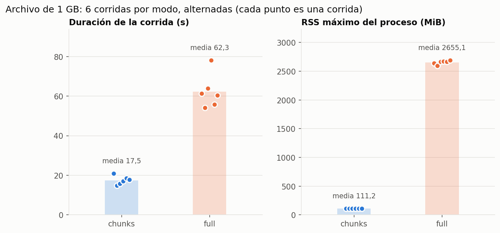

Cada punto es una corrida. En duración y en memoria, los puntos de los dos modos no se solapan en ningún caso.

### Gráfica 2: una corrida de cada modo, lado a lado

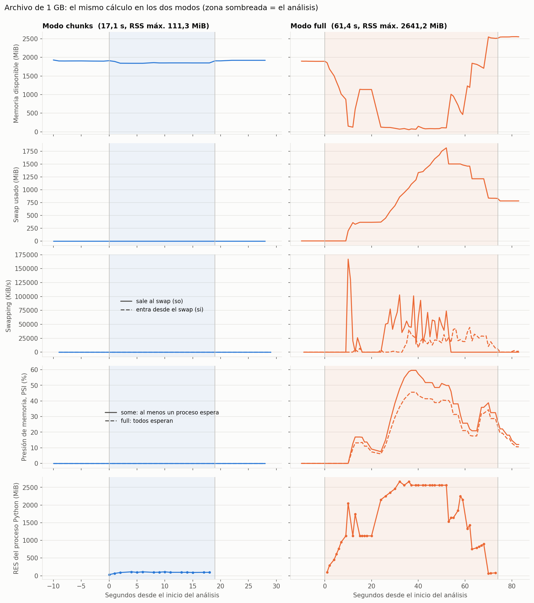

Es la gráfica que correlaciona todo (columna izquierda `chunks`, derecha `full`, la zona sombreada es el análisis):

- **Memoria disponible** (`free`): en `chunks` baja de unos 1900 a 1840 MiB y se queda ahí. En `full` cae a unos 100 MiB en cuanto empieza la carga.
- **Memoria virtual** (swap usado): en `chunks` es 0 todo el tiempo. En `full` sube a 1817 MiB y, al terminar el proceso, baja pero **queda cerca de 780 MiB ocupados** en el swap (páginas que nadie volvió a necesitar). Por eso la corrida siguiente no parte de cero.
- **Swapping** (`si`, `so`): en `full` hay un pico de `so` de unos 167 000 KiB/s a los 10 s, justo cuando la memoria disponible se desploma, y luego un segundo tramo de unos 25 s con `so` y `si` simultáneos. Que entren y salgan páginas a la vez significa que el sistema saca páginas que enseguida vuelve a necesitar, que es la señal clásica de **hiperpaginación**.
- **Presión de memoria** (PSI): el `some` sube a un 17 % en el primer tramo y llega a casi 60 % hacia el segundo 38; `full` va un poco por debajo (unos 45 %). Es decir, durante varios segundos **todos** los procesos útiles estaban esperando por memoria.
- **Procesos** (`RES` de Python en `top`): en `chunks` es una línea plana de unos 110 MiB. En `full` sube a más de 2500 MiB, y la forma coincide con la de las otras gráficas: baja a 1100 MiB mientras el swap se dispara (el kernel le quita páginas) y cae casi a cero al terminar.

### Gráfica 3: las 12 corridas superpuestas

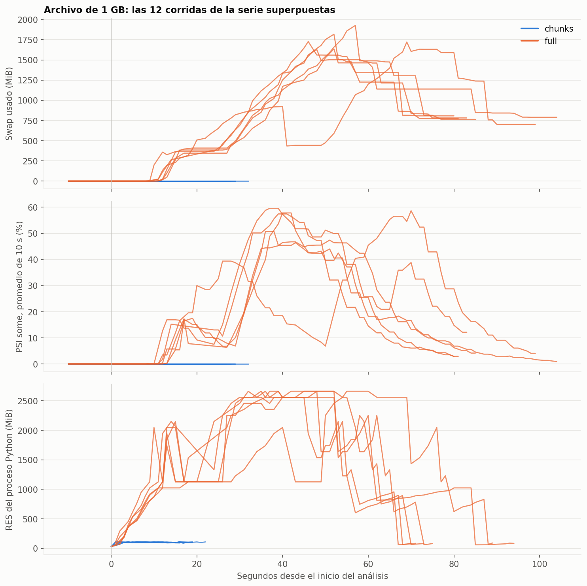

Las seis corridas de `full` siguen la misma forma (swap sube desde el segundo 10, la presión de memoria alcanza un máximo cerca del segundo 40, `RES` llega al techo de unos 2600 MiB) pero con tiempos desplazados (una corrida, la de 78 s, se alarga mucho más que las otras). Las seis de `chunks` son una línea pegada al cero. Esto confirma que el comportamiento de la gráfica 2 es representativo y no un caso aislado.

### Correlación entre las series

Se calculó el coeficiente de Pearson dentro de la ventana del análisis (muestras alineadas por segundo) para las seis corridas de `full`:

| Par de series | Media de las 6 corridas | Lectura |
|---|---|---|
| `RES` de Python y memoria disponible | **-0,95** (de -0,97 a -0,94) | Correlación negativa casi perfecta: cuando el proceso crece, la memoria disponible baja, y es el proceso Python quien la consume |
| `RES` de Python y swap usado | 0,45 (de 0,34 a 0,53) | Positiva moderada: el swap crece junto con el proceso, pero con retardo (el swap se llena después y se vacía poco al final, mientras `RES` ya cayó) |
| `so` y PSI `some` | 0,40 (de 0,32 a 0,48) | Positiva moderada: más páginas enviadas al swap implican más espera, pero la presión también se mantiene alta cuando `so` baja, porque el promedio de 10 s decae despacio |

En `chunks` la correlación `RES`-memoria disponible también es negativa (-0,79), pero con variaciones de apenas decenas de MiB; las demás no se calculan porque swap y PSI valen cero todo el tiempo (no hay variación que correlacionar).

### Gráfica 4: la corrida de 2 GB que no termina

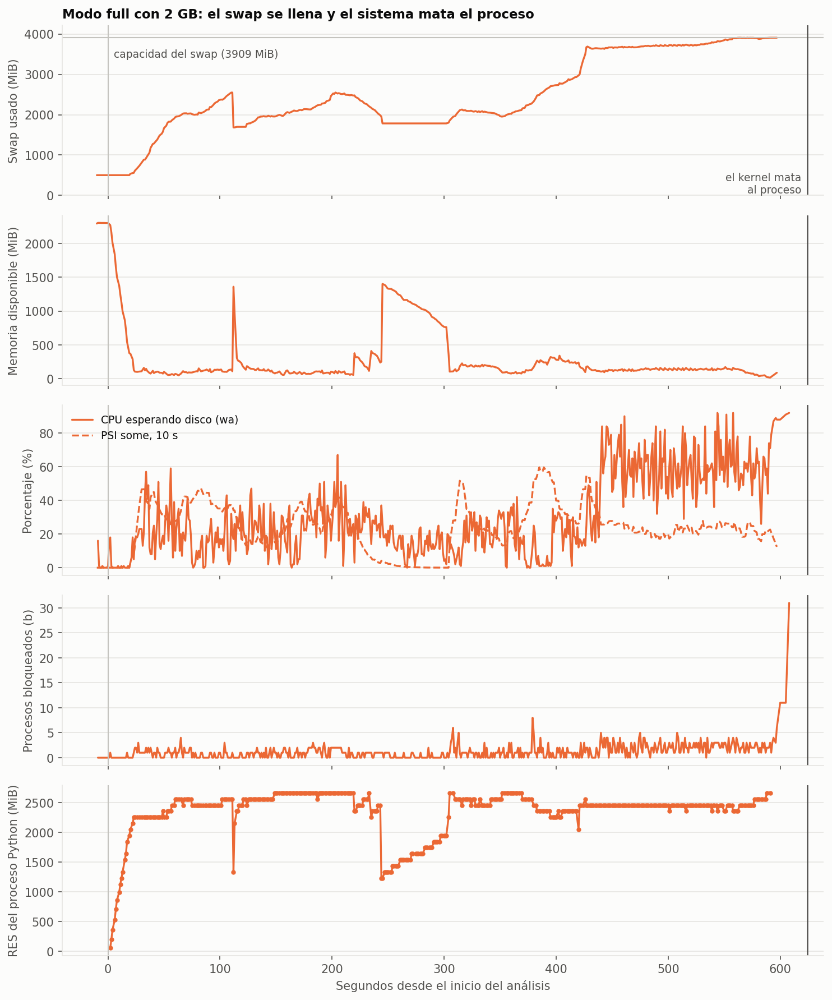

Con los datos que se alcanzaron a guardar (608 s de muestras; el kernel mató el proceso en el segundo **624** de la corrida, según el registro del sistema, por eso la última muestra queda unos 16 s antes de la línea vertical):

- El swap sube hasta **3909 MiB, su capacidad total**, y allí se queda.
- La memoria disponible baja a un mínimo de **17 MiB**.
- El `RES` de Python se mantiene entre 2200 y 2700 MiB casi todo el tiempo: no es que el proceso crezca sin parar, es que el sistema no tiene a dónde mover más páginas.
- La CPU espera al disco en promedio **30,5 %** de los segundos y llega a **92 %** al final. Los procesos bloqueados suben de 0 a 5 en casi toda la corrida y **a 31 al final**.
- El PSI `some` (promedio de 10 s) superó el 59 % y estuvo por encima de cero unos 149 s sumados, con `full` hasta 36,7 %.
- Los saltos bruscos de memoria disponible (a los 112 s y a los 245 s) coinciden con caídas del `RES` de Python a unos 1300 MiB: el kernel le quitó páginas al proceso para llevarlas al swap y, al volver a necesitarlas, el proceso las trajo de nuevo. El sistema oscilaba sin lograr avanzar.

### Gráfica 5: cómo escala con el tamaño

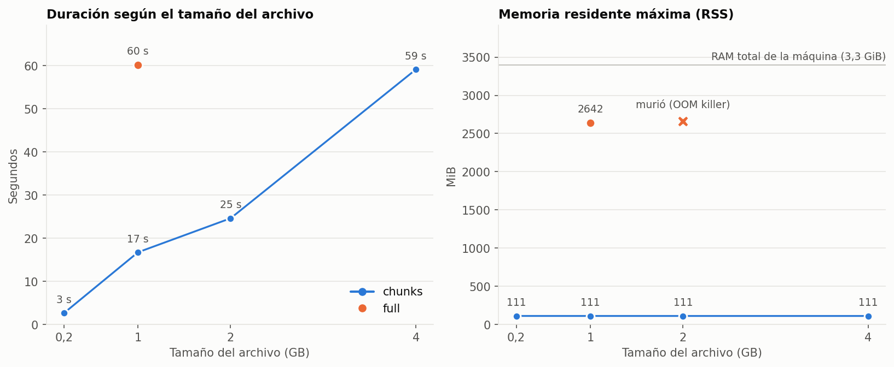

| Tamaño | `chunks`: duración | `chunks`: RSS | `full` |
|---|---|---|---|
| 0,2 GB | 2,6 s | 111 MiB | no se ejecutó |
| 1 GB | 17 s (media de 6) | 111 MiB | 60 s, 2642 MiB |
| 2 GB | 24,6 s | 111 MiB | **muere** a los 624 s |
| 4 GB | 59,1 s | 111 MiB | no se ejecutó |

La memoria de `chunks` es una línea horizontal; la de `full` ya con 1 GB está a más de un 75 % de la RAM total de la máquina (línea gris del gráfico), y con 2 GB el proceso desaparece.

> La gráfica 5 usa las medias cuando hay varias corridas del mismo tamaño y modo, por eso `chunks` con 1 GB aparece en 17 s y no en los 12,2 s de la primera corrida exploratoria del Paso 4.1.

---

## Paso 7: Interpretación

### Diferencia entre `full` y `chunks`

Con lo observado hasta ahora (hasta 4 GB):

| | `full` | `chunks` |
|---|---|---|
| Qué hace | Lee todo el CSV a un DataFrame y después consulta | Lee 100 000 filas, las consulta, descarta ese bloque y acumula el resultado parcial |
| Memoria máxima | Crece con el tamaño del archivo (4,5 veces el CSV en el DataFrame) | **Constante**: unos 111 MiB con 200 MB, 1, 2 y 4 GB |
| Tiempo | Mucho mayor cuando la memoria no alcanza (el swap pone al disco en medio) | Casi lineal con el archivo: 2,6 s, 12,2 s, 24,6 s y 59,1 s para 0,2, 1, 2 y 4 GB |
| Swap y presión | Usa swap, descarta la caché y, si todo se llena, el sistema mata el proceso | No usa swap |
| Límite | El DataFrame debe caber en RAM + swap (con 1 GB sí, con 2 GB no) | Ninguno práctico: procesó 4 GB en una máquina de 3,3 GiB |
| Resultado | El mismo cuando termina | El mismo |

Por qué ocurre:

- En `full` el DataFrame tiene que existir completo en memoria antes de la consulta, así que necesita varias veces el tamaño del CSV (cada fila se convierte en objetos de Python, más las copias que crean el filtro y la columna calculada). Cuando eso supera la RAM, el sistema **envía al swap** páginas de memoria anónima (las del DataFrame, que no tienen archivo de respaldo) y por eso aparecen `swpd`, `si` y `so`.
- En `chunks` la memoria depende del **tamaño del bloque** (100 000 filas) y no del archivo; cada bloque se libera al terminar. Por eso el RSS no cambia con el tamaño del archivo.
- `chunks` funciona aquí porque la consulta es una **suma por grupo**, que se puede acumular parcialmente (`acumulado.add(parcial)`). No todas las consultas se pueden partir así: una mediana exacta, un orden global o una unión entre tablas grandes necesitan una estrategia distinta.

### Qué pasa cuando el archivo supera la memoria

Con 1 GB, `full` todavía termina porque el DataFrame (4,2 GiB estimados) cabe en RAM + swap (7,1 GiB), pero a un costo alto. En las 6 corridas repetidas: **3,56 veces más tiempo**, 23,9 veces más memoria, entre 1,6 y 1,9 GiB de swap adicional, la memoria disponible cae a unos 63 MiB y el máximo de la presión de memoria es en promedio de 55 % para `some` y 42 % para `full`. Con 2 GB, el DataFrame estimado (8,5 GiB) ya no cabe: el swap se llena (3909 MiB), la máquina pasa más de 10 minutos casi sin avanzar (88 % a 92 % de espera de disco al final) y el OOM killer del kernel mata el proceso sin entregar ningún resultado. Es una falla total, no una degradación gradual.

Los indicadores aparecen en un orden que sirve para diagnosticar. Primero baja la memoria disponible, luego suben `so` y el swap usado, después aparece la presión PSI `some`, y finalmente `full` y la espera de disco; el proceso muere cuando el swap llega a su capacidad. La presión de memoria (PSI) es el aviso más temprano y más directo: en `chunks` vale 0 siempre y en `full` supera el 40 % varios segundos.

### Variabilidad y límites de las mediciones

- El tiempo de `full` es muy variable (54 a 78 s, un 40 % de diferencia entre la mejor y la peor corrida) porque depende del estado del swap y de la caché; el de `chunks` varía de 15 a 21 s (la primera corrida de la serie fue la más lenta). Por eso se reportan medias con mínimo y máximo y no una sola corrida.
- La memoria de `chunks` es prácticamente determinista (111,0 a 111,5 MiB); la de `full` también es estable (2598 a 2692 MiB), pero ese tope lo fija la RAM disponible, no el programa: Python quiere 4,2 GiB y el sistema solo le deja unos 2,6 GiB en RAM, el resto va al swap. En una máquina con más RAM el RSS sería mayor y el tiempo menor.
- Las gráficas de `RES` usan una muestra de `top` por segundo y solo se interpretan dentro de la ventana del análisis, porque fuera de ella `top` muestra otro proceso `python`.
- No se corrió `full` con 4 GB (ni con 200 MB): con 2 GB ya muere, y 4 GB no aportaría un dato nuevo.

---

## Pregunta extra: ¿se puede hacer en Windows tradicional?

**Sí, con dos salvedades.** La parte de monitoreo existe en Windows, pero hay que adaptar el script de análisis y las herramientas son otras.

**1. El script del profesor no corre tal cual en Windows.** `analizar_datos.py` importa el módulo `resource`, que solo existe en Linux y macOS, y la estimación de memoria usa `/proc/meminfo`. Habría que cambiar esa parte para medir el pico de memoria con otra librería, por ejemplo `psutil` (`psutil.Process().memory_info()`, que da el *working set*, la memoria física en uso). El resto del script, que es pandas puro, funciona igual.

**2. El monitoreo se hace con los contadores de rendimiento de Windows**, que equivalen a los comandos de Linux:

| Qué se observa | Linux | Windows (contador de rendimiento) |
|---|---|---|
| Memoria virtual y swap | `vmstat`, `free` | `\Memory\Available MBytes`, `\Paging File(_Total)\% Usage` |
| Swapping (entrada y salida de páginas) | columnas `si` y `so` | `\Memory\Pages Input/sec` y `\Memory\Pages Output/sec` |
| Procesos | `top` | `\Process(python)\Working Set` y `\Process(python)\Page Faults/sec` |
| Presión de memoria | `/proc/pressure/memory` | No existe un PSI exacto; lo más cercano son los *hard page faults* (`Pages Input/sec`) y la poca memoria disponible |

La herramienta de línea de comandos es `typeperf`, que ya viene con Windows y guarda las muestras en un archivo CSV, listo para procesar:

```powershell
typeperf "\Memory\Available MBytes" "\Memory\Pages Input/sec" "\Memory\Pages Output/sec" "\Paging File(_Total)\% Usage" "\Process(python)\Working Set" -si 1 -f CSV -o metricas_windows.csv
```

`-si 1` toma una muestra por segundo, igual que `vmstat 1`. También sirve el monitor de rendimiento (`perfmon`) con un *conjunto de recopiladores de datos*, o `Get-Counter ... | Export-Counter` en PowerShell. Otra opción es usar WSL2, que es un Linux completo y permite correr los scripts sin cambios, aunque WSL limita su propia memoria (archivo `.wslconfig`) y no ve la memoria de Windows de la misma forma.

> **Nota:** esta respuesta es de investigación; los comandos de Windows no se ejecutaron en esta entrega.

---

## Problemas encontrados y cómo se resolvieron

El enunciado pide identificar las otras razones por las que los procesos pueden fallar. Lo que apareció:

| Problema | Causa | Solución |
|---|---|---|
| El generador rechaza `--size-gb 1` | El script exige entre 20 y 50 GB y el disco solo tenía 11 GB libres | Se bajó el mínimo a 1 GB (ver "Material usado") |
| `analizar_datos.py --mode full` se detiene sin ejecutar | Protección del script: el CSV supera el 35 % de la memoria disponible | Se usa `--force` en la máquina virtual aislada |
| El enunciado dice `--chuck-size` | Error de tipeo del PDF; el parámetro real es `--chunk-size` | Se usa `--chunk-size` (por defecto ya vale 100 000) |
| `full` con 2 GB termina sin resultado | El DataFrame (8,5 GiB) no cabe en RAM + swap (7,1 GiB) y el OOM killer del kernel mata el proceso, junto con el script y el monitoreo de esa terminal | Es el comportamiento esperado: se usa `chunks`. Se documenta la corrida en el Paso 4.2 |
| El disco quedó al 86 % | Los tres archivos ocupan 7 GB de los 11 libres | Se evita generar más archivos y se borran los CSV al terminar |
| Las corridas no parten de cero | El swap usado por una corrida queda ocupado en la siguiente (`swpd` de unos 483 MiB antes de la segunda corrida de `full`) | Se repiten las corridas y se vacía la caché de archivos antes de cada una |
| El script no corre en Windows | Importa `resource` y lee `/proc` | Ver la pregunta extra |

---

## Conclusiones

**¿Qué sucede cuando se intenta analizar un archivo que supera la RAM disponible?** Depende de cuánto la supere. Mientras el programa cabe en RAM más swap, sigue funcionando pero muy degradado: con 1 GB (DataFrame de unos 4,2 GiB en una máquina de 3,3 GiB de RAM) `full` terminó, pero con **3,56 veces más tiempo**, 1,7 GiB de swap adicional, la memoria disponible en 63 MiB y una presión de memoria de hasta 60 %. Cuando no cabe, con 2 GB (DataFrame de 8,5 GiB contra 7,1 GiB de RAM y swap), el swap se llena, el sistema pasa más de 10 minutos con 88 % a 92 % de la CPU esperando disco y el kernel mata el proceso (OOM killer, señal 9), sin entregar resultado y arrastrando consigo el script y el monitoreo de esa terminal.

**¿Cómo se resuelve sin agregar memoria física?** Procesando el archivo por bloques (`chunks`): se lee un bloque de 100 000 filas, se calcula su parcial, se acumula y se descarta el bloque. La memoria depende del tamaño del bloque, no del archivo. Con los mismos 111 MiB se procesaron 200 MB, 1, 2 y 4 GB (este último más grande que toda la RAM), sin tocar el swap, sin presión de memoria y con el mismo resultado numérico que `full`. El tiempo crece de forma casi lineal con el tamaño (2,6 s, 17 s, 24,6 s y 59,1 s para 0,2, 1, 2 y 4 GB).

**Lo aprendido:**

1. **El tiempo de ejecución no es lo único que importa; la memoria decide si el programa termina o no.** `full` falla de golpe, no de forma gradual.
2. **El swap es una red de seguridad, no memoria extra:** el disco es mucho más lento que la RAM, así que entrar en swap multiplica el tiempo y al llenarse mata el proceso.
3. **La presión de memoria (PSI) es el mejor indicador de sufrimiento**, antes de que ocurra el fallo, y la correlación `RES` contra memoria disponible (-0,95) permite identificar al proceso responsable.
4. **Un algoritmo que procesa por bloques cambia el problema de espacio a tiempo:** gasta memoria constante, pero hay que poder acumular el resultado parcialmente (suma por grupo sí; mediana exacta u orden global, no).
5. **Un solo experimento no basta:** el mismo `full` con 1 GB tardó entre 45 s y 78 s en distintas corridas, por eso se repitió alternando los modos.

**Otras razones por las que un proceso puede fallar** (el enunciado pregunta por ellas), además de quedarse sin memoria: falta de espacio en disco (el generador rechazó un archivo de 20 GB con 11 GB libres), permisos de archivo (el `Permission denied` del Taller 3), parámetros mal escritos (`--chuck-size`), o dependencias del sistema operativo (`resource` y `/proc` no existen en Windows). Todas aparecieron en este taller y están en la tabla de problemas.
